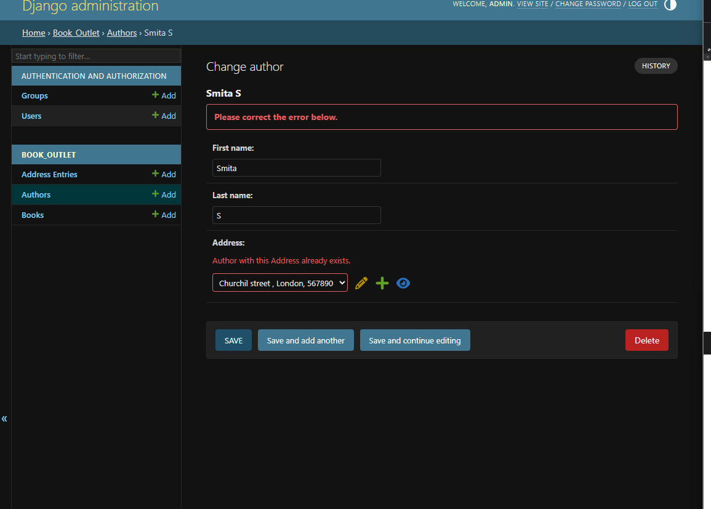
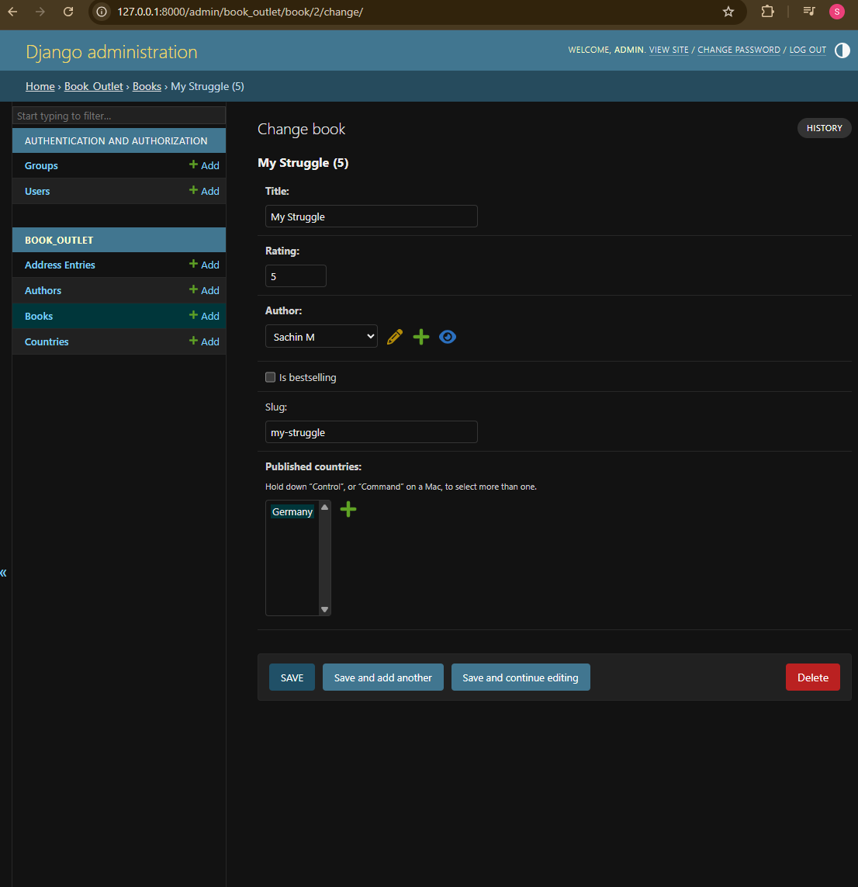

## Section 6: Data and models

## django-admin startproject book_store

    - Creates a new Django project named "book_store" (inside django_complete/,
      next to mypage, monthly_challenges and my_site).
    - Makes a folder "book_store" containing:
        manage.py          -> tool to run project commands (runserver, migrate, startapp, ...)
        book_store/        -> project settings package
            __init__.py    -> marks the folder as a Python package
            settings.py    -> project configuration (installed apps, database, etc.)
            urls.py        -> main URL routes of the site
            asgi.py        -> entry point for async web servers
            wsgi.py        -> entry point for regular web servers

## python manage.py startapp book_outlet

    - Creates the "book_outlet" app (admin.py, apps.py, migrations/, models.py,
      tests.py, views.py).
    - Registered in book_store/settings.py:
        INSTALLED_APPS = [
            ...
            'django.contrib.staticfiles',
            'book_outlet'
        ]
      (needed for models + migrations, not only templates).

## Database setting (SQLite by default)

    - settings.py:
        DATABASES = {
            'default': {
                'ENGINE': 'django.db.backends.sqlite3',
                'NAME': BASE_DIR / 'db.sqlite3',
            }
        }
    - SQLite = a SQL database stored in ONE file (db.sqlite3), no server needed;
      good for development. Production often uses PostgreSQL/MySQL (change ENGINE).
    - SQL databases store data in tables (rows + columns); see SQL vs NoSQL link.

## First model (book_outlet/models.py)

    - A model = a Python class that describes one database table:
        from django.db import models

        class Book(models.Model):
            title = models.CharField(max_length=50)
            rating = models.IntegerField()
    - class Book(models.Model) -> table book_outlet_book (app name + model name).
    - Each class attribute = a column:
        CharField(max_length=50) -> text, max 50 characters (max_length required)
        IntegerField()           -> whole numbers
    - Django adds an id column automatically (primary key, BigAutoField, 1, 2, 3...).
    - No SQL written by hand - Django's ORM turns Python into SQL.

## Migrations (makemigrations + migrate)

    - python manage.py makemigrations
        -> compares models.py with existing migrations and writes a new file:
           book_outlet/migrations/0001_initial.py
        operations = [
            migrations.CreateModel(
                name='Book',
                fields=[
                    ('id', models.BigAutoField(auto_created=True, primary_key=True, ...)),
                    ('title', models.CharField(max_length=50)),
                    ('rating', models.IntegerField()),
                ],
            ),
        ]
      (only a plan/instructions - the database is NOT changed yet)
    - python manage.py migrate
        -> runs all migrations not yet applied -> creates the tables in db.sqlite3:
           book_outlet_book + Django's own (auth_user, django_session, admin...).
    - Applied migrations are recorded in the django_migrations table, so each
      runs only once.
    - Rule: change models.py -> makemigrations -> migrate.
    - Migration files ARE committed to git (they describe the database);
      db.sqlite3 is NOT (it's in .gitignore).

## Inserting data with the Django shell (save)

    - python manage.py shell -> Python shell with the project loaded.
    - Create a row:
        >>> from book_outlet.models import Book
        >>> harry_potter = Book(title="h1", rating=5)
        >>> harry_potter.save()        # INSERT INTO book_outlet_book ...
        >>> lord_of_the_rings = Book(title="lr", rating=4)
        >>> lord_of_the_rings.save()
    - Book(...) only creates a Python object; save() writes it to the database.
    - id is filled in automatically: now the table has
        id 1 -> "h1", rating 5
        id 2 -> "lr", rating 4
    - Read them back:
        >>> Book.objects.all()
        <QuerySet [<Book: Book object (1)>, <Book: Book object (2)>]>

## __str__ (readable output for a model)

    - Default output "Book object (1)" says nothing about the book.
    - models.py:
        class Book(models.Model):
            title = models.CharField(max_length=50)
            rating = models.IntegerField()

            def __str__(self):
                return f"{self.title} ({self.rating})"
    - Now (restart the shell to load the change):
        >>> Book.objects.all()
        <QuerySet [<Book: h1 (5)>, <Book: lr (4)>]>
    - __str__ is a normal Python method, NOT a field -> no new column,
      no makemigrations needed.
    - Also used later by the admin site and anywhere the object is printed.

## Changing a model: new fields + second migration

    - models.py:
        from django.core.validators import MinValueValidator, MaxValueValidator

        class Book(models.Model):
            title = models.CharField(max_length=50)
            rating = models.IntegerField(validators=[MinValueValidator(1), MinValueValidator(5)])
            author = models.CharField(null=True, max_length=100)
            is_bestselling = models.BooleanField(default=False)
    - makemigrations -> 0002_book_author_book_is_bestselling_alter_book_rating.py:
        AddField   author
        AddField   is_bestselling
        AlterField rating      (validators changed)
      dependencies = [('book_outlet', '0001_initial')] -> runs after 0001.
    - migrate -> the table now has columns author and is_bestselling.

## New fields and EXISTING rows (null=True / default)

    - The table already had 2 books. A new column needs SOME value for them:
        author = CharField(null=True, ...)       -> old rows get NULL (None)
        is_bestselling = BooleanField(default=False) -> old rows get False
    - Without null=True or a default, makemigrations asks for a one-off
      default value to fill in the existing rows.
    - Database now:
        (1, 'h1', 5, author=None, is_bestselling=False)
        (2, 'lr', 4, author=None, is_bestselling=False)
    - null=True  -> the DATABASE allows empty (NULL).
      blank=True -> FORMS/validation allow empty (different thing, used later).

## Updating data in the shell (change attribute + save)

    - After adding author and is_bestselling, the 2 old books had author=None,
      is_bestselling=False. Updated them in python manage.py shell:
        >>> from book_outlet.models import Book
        >>> harry_potter = Book.objects.all()[0]
        >>> harry_potter.author = "JK"
        >>> harry_potter.is_bestselling = True
        >>> harry_potter.save()        # row exists (has an id) -> UPDATE, not INSERT
        >>> lord_of_the_rings = Book.objects.all()[1]
        >>> lord_of_the_rings.author = "Kaiser"
        >>> lord_of_the_rings.is_bestselling = True
        >>> lord_of_the_rings.save()
    - save() on an object that already has an id -> UPDATE that row;
      on a new object (no id yet) -> INSERT a new row.
    - Book.objects.all()[0] -> first row (slicing a QuerySet = SQL LIMIT 1).
    - Database now:
        (1, 'h1', 5, 'JK', True)
        (2, 'lr', 4, 'Kaiser', True)

## Deleting data (delete)

    - In python manage.py shell:
        >>> hp = Book.objects.all()[0]
        >>> hp.delete()
        (1, {'book_outlet.Book': 1})
        >>> Book.objects.all()
        <QuerySet [<Book: lr (4)>]>
    - delete() removes the row from the database right away (no save() needed).
    - Return value (1, {'book_outlet.Book': 1}) =
        (total rows deleted, {model: rows deleted per model})
      (later, with related models, one delete can remove more rows).
    - The Python object hp still exists in memory, but its id is now None;
      calling hp.save() again would INSERT it as a NEW row with a new id (3).
    - Only "lr" (id 2) is left. Deleted ids are NOT reused - the next new
      book gets id 3.

## Creating data in one step (objects.create)

    - In python manage.py shell:
        >>> Book.objects.create(title="hp1", rating=5, author="JK", is_bestselling=True)
        <Book: hp1 (5)>
        >>> Book.objects.create(title="my struggle", rating=2, author="sachin", is_bestselling=False)
        <Book: my struggle (2)>
        >>> Book.objects.create(title="will_power", rating=1, author="Nanee", is_bestselling=False)
        <Book: will_power (1)>
        >>> Book.objects.all()
        <QuerySet [<Book: lr (4)>, <Book: hp1 (5)>, <Book: my struggle (2)>, <Book: will_power (1)>]>
    - objects.create(...) = Book(...) + save() in ONE call; returns the saved object.
    - New ids continue after the deleted one: lr = 2, hp1 = 3, my struggle = 4,
      will_power = 5.

## Error: unterminated string literal (missing quote)

    - Typed:
        Book.objects.create(title="hp1,rating=5,author="JK",is_bestselling=True)
        SyntaxError: unterminated string literal (detected at line 1)
    - Missing " after hp1 -> Python read "hp1,rating=5,author=" as ONE string,
      then JK, then a " that is never closed.
    - Fix: close each string: title="hp1", rating=5, author="JK"
    - Python error (SyntaxError) - happens before Django runs anything.

## Validators don't run on save()/create()

    - rating=2 and rating=1 were saved with no error, although the field has
      validators=[MinValueValidator(1), MinValueValidator(5)] (needs >= 5).
    - Proof that validators only run during validation (forms, admin,
      book.full_clean()), not on save() or objects.create().
    - In the shell, check first with full_clean():
        >>> b = Book(title="x", rating=2)
        >>> b.full_clean()
        ValidationError: {'rating': ['Ensure this value is greater than or equal to 5.']}

## get() needs exactly ONE match (MultipleObjectsReturned)

    - In python manage.py shell:
        >>> Book.objects.get(is_bestselling=True)
        book_outlet.models.Book.MultipleObjectsReturned:
            get() returned more than one Book -- it returned 2!
    - Two books are bestsellers (lr and hp1), but get() must find EXACTLY one:
        0 matches   -> Book.DoesNotExist
        1 match     -> that object
        2+ matches  -> Book.MultipleObjectsReturned
    - Use get() for unique things (id/pk, slug):
        >>> Book.objects.get(id=3)
        <Book: hp1 (5)>
    - Use filter() when there can be several (returns a QuerySet, can be empty):
        >>> Book.objects.filter(is_bestselling=True)
        <QuerySet [<Book: lr (4)>, <Book: hp1 (5)>]>
    - Want just one of several -> filter(...).first() (None if none match).

## filter() and comparison lookups (lt, gt, ...)

    - In python manage.py shell:
        >>> Book.objects.filter(is_bestselling=True)
        <QuerySet [<Book: lr (4)>, <Book: hp1 (5)>]>
        >>> Book.objects.filter(rating__lt=3)
        <QuerySet [<Book: my struggle (2)>, <Book: will_power (1)>]>
    - filter() returns a QuerySet with ALL matching rows (0, 1 or many) -
      unlike get(), no error for several matches.
    - rating__lt=3 -> SQL WHERE rating < 3. Comparison lookups:
        __lt   <      __lte  <=
        __gt   >      __gte  >=
    - Several conditions in one filter() = AND:
        >>> Book.objects.filter(rating__lt=3, author__icontains="sachin")
        <QuerySet [<Book: my struggle (2)>]>

## OR / AND with Q objects

    - Plain keyword arguments in filter() are always AND. For OR -> Q objects:
        >>> from django.db.models import Q
        >>> Book.objects.filter(Q(rating__lt=3) | Q(is_bestselling=True))
        <QuerySet [<Book: lr (4)>, <Book: hp1 (5)>, <Book: my struggle (2)>, <Book: will_power (1)>]>
      -> rating < 3 OR bestseller (all 4 books match one or the other).
    - Operators on Q:  |  = OR     &  = AND     ~Q(...) = NOT
    - Combining OR with AND - separate arguments are ANDed:
        >>> Book.objects.filter(Q(rating__lt=3) | Q(is_bestselling=True), Q(author="JK"))
        <QuerySet [<Book: hp1 (5)>]>
        >>> Book.objects.filter(Q(rating__lt=3) | Q(is_bestselling=True), author="JK")
        <QuerySet [<Book: hp1 (5)>]>
      Both = (rating < 3 OR bestseller) AND author = "JK" -> only hp1.
      Same as: filter((Q(rating__lt=3) | Q(is_bestselling=True)) & Q(author="JK"))

## Error: positional argument follows keyword argument

    - Typed:
        Book.objects.filter(author="JK", Q(rating__lt=3) | Q(is_bestselling=True))
        SyntaxError: positional argument follows keyword argument
    - Python rule (not Django): positional arguments (the Q(...) objects)
      must come BEFORE keyword arguments (author="JK").
    - Fix: put the Q first ->
        Book.objects.filter(Q(rating__lt=3) | Q(is_bestselling=True), author="JK")
      or wrap the keyword in a Q too: Q(author="JK") (then order doesn't matter).

## Query performance: QuerySets are lazy (and cached)

    - In python manage.py shell:
        >>> best_sellers = Book.objects.filter(is_bestselling=True)
        >>> top_bs = Book.objects.filter(rating__gt=3)
        >>> print(best_sellers)
        <QuerySet [<Book: lr (4)>, <Book: hp1 (5)>]>
        >>> print(top_bs)
        <QuerySet [<Book: lr (4)>, <Book: hp1 (5)>]>
    - LAZY: creating/storing a QuerySet does NOT hit the database.
        best_sellers = ...filter(...)   -> no SQL yet, just a description
        print(best_sellers)             -> NOW the SQL runs
      A query runs only when the data is needed: print, for loop, list(),
      len(), [index], bool / if.
    - CHAINING builds ONE bigger query instead of several:
        >>> best_sellers = Book.objects.filter(is_bestselling=True)
        >>> top_bs = best_sellers.filter(rating__gt=4)
        >>> print(top_bs)              # ONE query: WHERE is_bestselling AND rating > 4
        <QuerySet [<Book: hp1 (5)>]>
      (My top_bs = Book.objects.filter(rating__gt=3) started fresh, so it is
       NOT "top bestsellers" - it's every book with rating > 3; same result
       here only by coincidence.)
    - CACHING: once a stored QuerySet is fully evaluated (for loop, list()),
      its results are kept:
        >>> list(best_sellers)         # query runs
        >>> list(best_sellers)         # reused from cache, no new query
      but a NEW QuerySet always queries again:
        >>> list(Book.objects.filter(is_bestselling=True))   # query
        >>> list(Book.objects.filter(is_bestselling=True))   # query again
      -> store a QuerySet in a variable when you use the same data twice.
    - Exception: print() of a QuerySet does NOT fill the cache (it runs its own
      LIMIT 21 query each time) -> print(best_sellers) twice = 2 queries.
    - Measured on my db (connection.queries):
        create QuerySet        -> 0 queries
        print/repr 2x          -> 2 queries
        list() 2x              -> 1 query (cached)
        best_sellers.filter(rating__gt=4) -> 1 query:
          WHERE is_bestselling = 1 AND rating > 4

## Bulk operations (many rows at once)

    - Besides working on ONE object (obj.save(), obj.delete()), whole groups
      of rows can be changed in a single query:
    - Delete many -> delete() on a QuerySet:
        >>> Book.objects.filter(rating__lt=2).delete()
        (1, {'book_outlet.Book': 1})
    - Update many with the SAME value -> update() on a QuerySet:
        >>> Book.objects.filter(author="JK").update(is_bestselling=False)
        1                                   # number of rows changed
    - Update many objects with DIFFERENT values -> bulk_update():
        >>> books = list(Book.objects.all())
        >>> books[0].rating = 5
        >>> books[1].rating = 3
        >>> Book.objects.bulk_update(books, ["rating"])
    - Create many -> bulk_create():
        >>> Book.objects.bulk_create([
        ...     Book(title="b1", rating=4),
        ...     Book(title="b2", rating=5),
        ... ])
    - Faster (one query instead of one per object), BUT they skip the model's
      save()/delete() methods (and signals) - fine for simple models.
    - (Examples only - not run on my db.)
    - Docs links in Helpful resources.

## Field lookups and case sensitivity in SQLite

    - Lookup syntax: field__lookup=value (two underscores).
    - Tested on my db:

| Query                                | Result          | Case-sensitive?        |
|--------------------------------------|-----------------|------------------------|
| `filter(title="HP1")`                | `[]`            | **yes** (exact match)  |
| `filter(title__iexact="HP1")`        | `hp1 (5)`       | no (i = ignore case)   |
| `filter(title__contains="Struggle")` | `my struggle (2)` | **no - SQLite only** |
| `filter(title__icontains="Struggle")`| `my struggle (2)` | no                   |
| `filter(author__contains="jk")`      | `hp1 (5)`       | **no - SQLite only**   |
| `filter(author__startswith="j")`     | `hp1 (5)`       | **no - SQLite only**   |

    - Why: SQLite runs contains / startswith / endswith as SQL LIKE, which
      ignores case (for English letters) -> on SQLite contains = icontains.
    - PostgreSQL / MySQL keep contains case-SENSITIVE -> same code, different
      results after switching database.
    - Rule: when case should be ignored, use the i-versions
      (iexact, icontains, istartswith, iendswith) - works the same everywhere.
    - Other lookups: lt, lte, gt, gte (e.g. rating__gte=4), in, isnull.

## Showing database data on a page (view -> template)

    - book_store/urls.py:
        path("", include("book_outlet.urls"))
    - book_outlet/urls.py (new):
        urlpatterns = [path("", views.index)]
    - book_outlet/views.py:
        from .models import Book

        def index(request):
            books = Book.objects.all()
            return render(request, "book_outlet/index.html", {"books": books})
      from .models -> "." = this app's folder (relative import).
    - Templates (namespaced, inside the app):
        book_outlet/templates/book_outlet/base.html     -> layout with title + content blocks
        book_outlet/templates/book_outlet/index.html:
            
            All Books
            
            <ul>
                
                <li>{{ book.title }} (Rating: {{ book.rating }})</li>
                
            </ul>
            
        book_outlet/templates/book_outlet/book_detail.html -> empty for now
    - base.html is inside the app here (no project-level templates/ folder),
      so extends uses the namespaced path "book_outlet/base.html".
    - Same pattern as the blog project, but the data now comes from the
      DATABASE (Book.objects.all()) instead of a Python list in views.py.
    - Lazy QuerySet in action: Book.objects.all() runs no SQL in the view;
      the query runs when the template's  loops over books.
    - http://127.0.0.1:8000/ ->
        lr (Rating: 4)
        hp1 (Rating: 5)
        my struggle (Rating: 2)
        will_power (Rating: 1)

## Book detail page (get_object_or_404)

    - book_outlet/urls.py:
        urlpatterns = [path("", views.index),
                       path("<int:id>", views.book_detail, name="book-detail")]
    - views.py:
        from django.shortcuts import render, get_object_or_404

        def book_detail(request, id):
            # try:
            #     book = Book.objects.get(pk=id)
            # except:
            #     raise Http404()
            book = get_object_or_404(Book, pk=id)
            return render(request, "book_outlet/book_detail.html",
                          {"title": book.title,
                           "author": book.author,
                           "rating": book.rating,
                           "is_bestseller": book.is_bestselling})
    - pk = "primary key" = id here (pk works even if the key has another name).
    - get_object_or_404(Model, ...) = get() + raise Http404 if nothing found,
      in ONE line (replaces the commented try/except).
    - book_detail.html:
        <h1>{{ title }}</h1>
        <h2>{{ author }}</h2>
        
The book has rating of {{ rating }}
             and is bestseller
             but isn't best seller 
        

    - Results:
        /3 -> hp1, JK, "rating of 5 and is bestseller"
        /4 -> my struggle, sachin, "rating of 2 but isn't best seller"
        /1 -> 404 (that book was deleted)
        /3/ -> 404 (route has no trailing slash)
    - Simpler: pass the whole object {"book": book} and use {{ book.title }} etc.

## Linking to the detail page:  vs get_absolute_url

    - First: named the route and used the url tag in index.html:
        <a href="">{{ book.title }}</a>
      -> lr /2, hp1 /3, my struggle /4, will_power /5
    - Then: moved the URL building INTO the model:
        from django.urls import reverse

        class Book(models.Model):
            ...
            def get_absoulte_url(self):
                return reverse("book-detail", args=[self.id])
      index.html:
        <a href="{{ book.get_absoulte_url }}">{{ book.title }}</a>
    - Why: the model knows its own URL; every template just uses
      {{ book.get_absolute_url }} - change the URL logic in ONE place.
    - Method called WITHOUT () in the template (DTL calls it automatically).
    - TYPO: get_absoulte_url -> should be get_absolute_url. It still works
      (same misspelling in both places), but Django looks for the exact name
      get_absolute_url (e.g. the admin's "View on site" button), so fix both.

## get() with no match (DoesNotExist)

    - In python manage.py shell:
        >>> print(Book.objects.get(title="hp"))
        book_outlet.models.Book.DoesNotExist: Book matching query does not exist.
    - The book was called "hp1", not "hp" -> exact match finds 0 rows.
    - get() errors: 0 matches -> DoesNotExist, 2+ -> MultipleObjectsReturned.
    - Safer options:
        Book.objects.filter(title__startswith="hp")   # QuerySet, no error
        Book.objects.filter(title="hp").first()       # None if no match

## Slug field + overriding save() (slugify)

    - models.py:
        from django.utils.text import slugify

        class Book(models.Model):
            ...
            slug = models.SlugField(default="", null=False)  # Harry Potter 1 => harry-potter-1

            def save(self, *args, **kwargs):
                self.slug = slugify(self.title)
                super().save(*args, **kwargs)
    - makemigrations -> 0003_book_slug.py (AddField slug, default '') -> migrate.
      Existing rows got the default '' (empty slug).
    - SlugField = CharField for URL-friendly text (letters, numbers, - and _),
      max_length 50 by default, indexed for fast lookups.
    - slugify("Harry Potter 1") -> "harry-potter-1"
      (lowercase, spaces -> "-", special characters removed; "_" is kept).
    - Overriding save(): my code runs first (set the slug), then
      super().save(*args, **kwargs) does the real saving. Forgetting super().save()
      = nothing is saved!
    - Renamed + re-saved the books so save() filled in every slug:
        2  Lord of the Rings  -> lord-of-the-rings   (was "lr")
        3  Harry Potter 1     -> harry-potter-1      (was "hp1")
        4  my struggle        -> my-struggle
        5  will_power         -> will_power
        >>> print(Book.objects.get(title="Harry Potter 1").slug)
        harry-potter-1
    - Old rows only get a slug when saved again (save() runs per object).
      Bulk methods (update(), bulk_create()) skip save() -> no slug.

## Slug URLs instead of ids (/harry-potter-1 instead of /3)

    - urls.py:
        path("<slug:slug>", views.book_detail, name="book-detail")
    - views.py:
        def book_detail(request, slug):
            book = get_object_or_404(Book, slug=slug)
            ...
    - models.py:
        def get_absoulte_url(self):
            return reverse("book-detail", args=[self.slug])
    - What happens, step by step:
        1. book.save()  -> my save() sets slug = slugify(title), then
                           super().save() writes the row
        2. index.html   -> {{ book.get_absoulte_url }} -> reverse() -> "/harry-potter-1"
        3. click        -> <slug:slug> matches -> book_detail(request, slug="harry-potter-1")
        4. view         -> get_object_or_404(Book, slug=slug) -> the book (or 404)
        5. template     -> renders "Harry Potter 1"
    - Results:
        /                 -> links /lord-of-the-rings, /harry-potter-1, /my-struggle, /will_power
        /harry-potter-1   -> Harry Potter 1 page
        /3                -> 404 (ids aren't used in URLs anymore)
    - Why: readable, SEO-friendly URLs.
    - Watch out:
        same title twice -> same slug -> get() finds 2 -> MultipleObjectsReturned
          -> use SlugField(unique=True)
        slug is rebuilt on every save -> renaming a book changes its URL
          (old links break)
        typo get_absoulte_url -> should be get_absolute_url

## db_index=True (database index)

    - models.py:
        slug = models.SlugField(default="", null=False, db_index=True)
    - An index = an extra lookup structure in the database, so searching by
      that column is fast (no scan through every row). Good for columns used
      in lookups, e.g. get_object_or_404(Book, slug=slug) on every detail page.
    - Cost: a bit more storage and slightly slower inserts/updates.
    - SlugField already has db_index=True by DEFAULT (index was created by
      0003_book_slug) -> adding it changes nothing:
        python manage.py makemigrations --dry-run
        No changes detected
      Kept it in the code anyway to make the intent clear.
    - For other fields (e.g. CharField) db_index=True must be added by hand
      -> then makemigrations creates an AlterField migration.
    - unique=True also creates an index AND blocks duplicates (would need a
      migration) - the fix for two books with the same slug.

## Aggregation: count() and aggregate(Avg) on the index page

    - views.py:
        from django.db.models import Avg

        def index(request):
            books = Book.objects.all().order_by("title")
            num_books = books.count()
            avg_rating = books.aggregate(Avg("rating"))  # {"rating__avg": 3.0}

            return render(request, "book_outlet/index.html", {
                "books": books,
                "total_number_of_books": num_books,
                "average_rating": avg_rating["rating__avg"],
            })
    - books.count() -> SQL SELECT COUNT(*) - the database counts, the books
      are NOT loaded into Python (faster than len(books)).
    - aggregate(Avg("rating")) -> the database calculates the average and
      returns a DICT; key = field name + "__avg" -> {"rating__avg": 3.0}.
      Others: Sum, Min, Max, Count; several at once:
        books.aggregate(Avg("rating"), Max("rating"))
        -> {"rating__avg": 3.0, "rating__max": 5}
    - index.html:
        
Total number of books: {{ total_number_of_books }}

        
Average rating: {{ average_rating|floatformat:1 }}

        

        <ul> ... </ul>
      floatformat:1 -> round to 1 decimal (3.6667 -> 3.7).
    - Result: Total number of books: 4, Average rating: 3.0  ((4+5+2+1) / 4)

## Ordering: order_by()

    - Book.objects.all().order_by("title") -> A-Z by title:
        Harry Potter 1, Lord of the Rings, my struggle, will_power
    - order_by("-title")           -> Z-A ("-" = descending)
    - order_by("-rating", "title") -> highest rating first, ties by title
    - SQLite sorts case-SENSITIVELY: uppercase letters come before lowercase
      ("Lord..." before "a book").
    - order_by doesn't change count() or aggregate() results.

## Section 6 complete (Data and models)

## Section 7: Django admin

## Admin site and createsuperuser

    - Admin = ready-made website to add / edit / delete rows:
        http://127.0.0.1:8000/admin/
      (path('admin/', admin.site.urls) is already in book_store/book_store/urls.py)
    - python manage.py createsuperuser
        -> asks username, email, password -> creates an admin user (mine: admin)
        -> stored in the auth_user table (created by the first migrate)
           id 1, username admin, is_superuser = True, is_staff = True
    - is_staff     -> may log in to the admin
      is_superuser -> has ALL permissions
    - Models only show up in the admin after they are registered in admin.py.

## Registering a model in the admin (admin.site.register)

    - book_outlet/admin.py:
        from django.contrib import admin

        from .models import Book

        admin.site.register(Book)
    - /admin/ now shows "BOOK_OUTLET -> Books" (app name + plural model name).
    - /admin/book_outlet/book/ lists the rows using __str__:
        will_power (1), my struggle (2), Harry Potter 1 (5), Lord of the Rings (4)
      (newest first by default).
    - Click a row -> edit form; "Add book" -> create; "Delete" -> remove.
    - The admin RUNS validation (unlike save() in the shell), so my model's
      settings show up in the forms:
        rating validators [MinValueValidator(1), MinValueValidator(5)] ->
          editing a book with rating 1-4 fails: "Ensure this value is greater
          than or equal to 5." (the MaxValueValidator bug)
        author has null=True but no blank=True -> admin says "This field is required"
        slug is editable in the form, but save() overwrites it with slugify(title)

## Fixing the rating validator (MaxValueValidator) - migration 0004

    - models.py:
        before: validators=[MinValueValidator(1), MinValueValidator(5)]   # >= 5 only
        after:  validators=[MinValueValidator(1), MaxValueValidator(5)]   # 1 to 5
    - makemigrations -> 0004_alter_book_rating.py:
        migrations.AlterField(model_name='book', name='rating',
            field=models.IntegerField(validators=[MinValueValidator(1), MaxValueValidator(5)]))
      dependencies = [('book_outlet', '0003_book_slug')]
    - migrate -> applied (0004 recorded in django_migrations).
    - Validators live only in Python (no database change), but Django still
      writes a migration so its record of the model stays complete.
    - Now the admin accepts ratings 1-5 and rejects 0 or 6+:
        "Ensure this value is less than or equal to 5."

## Slug field in the admin: blank=True, editable=False (migrations 0005, 0006)

    - models.py:
        slug = models.SlugField(default="", blank=True, editable=False,
                                null=False, db_index=True)
    - blank=True    (0005) -> the form allows the slug to be empty
                              (save() fills it from the title anyway).
    - editable=False (0006) -> the slug is NOT shown in admin/forms at all,
                              so nobody can type a slug that save() overwrites.
    - Each makemigrations created an AlterField migration:
        0005_alter_book_slug.py -> SlugField(blank=True, default='')
        0006_alter_book_slug.py -> SlugField(blank=True, default='', editable=False)
      Neither changes the database table (form/validation options only),
      but Django records them. Both applied (last = 0006).
    - Tip: make all changes first, then ONE makemigrations -> fewer files.

## Customising the admin: ModelAdmin + prepopulated_fields

    - book_outlet/admin.py:
        class BookAdmin(admin.ModelAdmin):
            prepopulated_fields = {"slug": ("title",)}

        admin.site.register(Book, BookAdmin)
    - ModelAdmin = a class with settings for how ONE model looks/works in the admin;
      passed as the 2nd argument to register().
    - prepopulated_fields -> while typing the title in the admin form, JavaScript
      fills the slug field live ("Harry Potter 1" -> "harry-potter-1"); the slug
      can still be edited by hand before saving.
    - ("title",) is a TUPLE - the trailing comma matters (("title") is just a string).
    - For this the slug must be visible in the form again -> removed editable=False:
        slug = models.SlugField(default="", blank=True, null=False, db_index=True)
      (a field with editable=False can't be in prepopulated_fields).
    - Removed the save() override - the admin now creates the slug instead.
    - makemigrations -> 0007_alter_book_slug.py (AlterField slug:
      SlugField(blank=True, default='') - editable=False removed) -> migrate (applied).
    - Watch out: without save(), books created in the SHELL (objects.create)
      get slug "" -> {{ book.get_absoulte_url }} -> reverse() with an empty slug
      -> NoReverseMatch -> the index page crashes. Only the admin fills slugs now.
    - Removed the now-unused "from django.utils.text import slugify" from models.py.
    - Decision: books are only added through the admin, so no save() override
      is needed (shell-created books would get slug "" - stored as an empty
      string - and break the index page links).

## Admin list page: list_display and list_filter

    - book_outlet/admin.py:
        class BookAdmin(admin.ModelAdmin):
            prepopulated_fields = {"slug": ("title",)}
            list_filter = ("author", "rating",)
            list_display = ("title", "author")
    - list_display -> which columns the list page shows (instead of only the
      __str__ text): Title | Author. Click a column header to sort by it.
    - list_filter -> a "FILTER" sidebar on the right with one section per field
      (By author, By rating); clicking a value filters the list via the URL,
      e.g. /admin/book_outlet/book/?rating=5
    - Both take a tuple/list of field NAMES (strings).
    - Other useful options: search_fields = ("title",) (search box),
      ordering = ("title",), list_per_page = 20.
    - Only changes the admin, not the database -> no migration needed.

## Using the admin: add and edit rows

    - Edited will_power -> is_bestselling now True.
    - Added a new book with "Add book" -> id 6, slug generated by save():
        (6, 'Mein Furher', 4, 'Hitler', True, 'mein-furher')
    - Admin saves go through the model's save() -> slug is set automatically,
      and validation runs (rating 1-5, author required).

## Section 7 complete (Django admin)

## blank vs null

|                  | `null=True`                    | `blank=True`                               |
|------------------|--------------------------------|--------------------------------------------|
| Applies to       | the **database** column        | **validation** (forms, admin, full_clean()) |
| Allows           | storing `NULL` (`None`)        | submitting the field empty                 |
| Default          | `False` -> column `NOT NULL`   | `False` -> field required in forms         |
| Changes the DB?  | yes (new migration alters column) | no (migration only records it)          |

    - Examples:
        CharField(max_length=100, null=True)               DB accepts NULL, forms still require it
        CharField(max_length=100, blank=True)              forms accept empty, saved as "" (empty string)
        CharField(max_length=100, null=True, blank=True)   optional, stored as NULL
    - Rules of thumb:
        text fields (CharField, TextField) -> blank=True only; empty = ""
          (null=True too gives two kinds of "empty": None and "" - avoid)
        numbers, dates, booleans, ForeignKey -> null=True, blank=True together
          (no "empty string" for a number, so NULL is the only "no value")
    - My author field has null=True only -> DB is fine with None, but the admin/
      forms will still say "This field is required". For an optional author:
      blank=True (or null=True, blank=True).

## Validators (MinValueValidator, MaxValueValidator)

    - validators=[...] -> checks run by Django when validating
      (forms, admin, model.full_clean()), NOT a database constraint:
      Book(title="x", rating=99).save() still saves 99 with no error.
    - Bug in my code: used MinValueValidator for BOTH limits ->
        [MinValueValidator(1), MinValueValidator(5)] = "at least 1 AND at least 5"
        = only 5+ allowed, and no upper limit.
      Should be:
        validators=[MinValueValidator(1), MaxValueValidator(5)]   # 1 to 5
      (MaxValueValidator was imported but not used.)
      Fixing it = another AlterField -> makemigrations + migrate again.

## Section 8: Relationships - one-to-many with ForeignKey

    - New model Author, and Book.author changed from text to a ForeignKey:
        class Author(models.Model):
            first_name = models.CharField(max_length=100)
            last_name = models.CharField(max_length=100)

        class Book(models.Model):
            ...
            author = models.ForeignKey(Author, on_delete=models.CASCADE, null=True)
    - One-to-many: one Author can have MANY books, each Book has ONE author.
      The ForeignKey goes on the "many" side (Book).
    - Author must be defined ABOVE Book (or use the string "Author") because
      Python reads the file top to bottom.
    - In the DB the column is book_outlet_book.author_id, storing the Author's id
      (not the name). book.author -> Author object, book.author_id -> the number.
    - on_delete = what happens to the books when their author is deleted:
        models.CASCADE    delete the books too
        models.PROTECT    refuse to delete the author while books point to it
        models.SET_NULL   set author to NULL (needs null=True)
        models.SET_DEFAULT / models.DO_NOTHING
    - makemigrations -> 0008_author_alter_book_author.py:
        CreateModel Author + AlterField book.author (CharField -> ForeignKey)
    - Gotcha before migrate: existing books still have TEXT in author
      ('Kaiser', 'JK', 'sachin', 'Nanee', 'Hitler'). Converting that column into
      author_id fails the foreign key check, because no Author has id 'Kaiser':
        IntegrityError: ... book_outlet_book.author_id contains a value 'Kaiser'
        that does not have a corresponding value in book_outlet_author.id
      Fix: delete the old books first, then migrate, then re-add them with
      real Author rows.
    - What actually happened: python .\manage.py migrate
        Applying book_outlet.0008_author_alter_book_author... Traceback ...
      -> the migration runs in a transaction, so on error it is ROLLED BACK:
         0008 still [ ] in showmigrations, no book_outlet_author table,
         the 5 books unchanged. Nothing broken - fix the data, migrate again.
    - Deleting the old books in the shell worked with the normal ORM:
        >>> from book_outlet.models import Book
        >>> Book.objects.all().delete()
        (5, {'book_outlet.Book': 5})      # (total deleted, per model)
      (it's a plain DELETE FROM book_outlet_book, no columns read, so the
      not-yet-existing author_id column didn't matter)
    - Then migrate succeeded:
        Applying book_outlet.0008_author_alter_book_author... OK
      DB now: book_outlet_book columns id, title, rating, is_bestselling, slug,
      author_id (old author text column gone) + new empty book_outlet_author table.
    - After that: register Author in admin.py (admin.site.register(Author)),
      add authors, re-add books and pick the author from the dropdown.

## Creating related rows in the shell (ForeignKey)

    - python .\manage.py shell
        >>> from book_outlet.models import Book, Author
        >>> jkr = Author(first_name="JK", last_name="Rowling")
        >>> jkr.save()
        >>> Author.objects.all()
        <QuerySet [<Author: Author object (1)>]>
        >>> hp1 = Book(title="Harry potter 1", rating=5, is_bestselling=True,
        ...            slug="harry-potter-1", author=jkr)
        >>> hp1.save()
    - Save the Author FIRST: it needs an id before a Book can point to it
      (an unsaved author -> ValueError: save() prohibited ... unsaved related object).
    - author=jkr -> pass the Author OBJECT; Django stores its id in author_id.
      (author_id=1 also works.)
    - Slug given by hand here because save() no longer creates it
      (only the admin's prepopulated_fields does).
    - DB after:
        book_outlet_author: (1, 'JK', 'Rowling')
        book_outlet_book:   (1, 'Harry potter 1', 5, True, 'harry-potter-1', author_id=1)
    - "Author object (1)" -> Author has no __str__ yet. Add one:
        def __str__(self):
            return f"{self.first_name} {self.last_name}"
    - Following the relation:
        hp1.author              -> the Author object
        hp1.author.last_name    -> 'Rowling'
        hp1.author_id           -> 1

## Querying across a ForeignKey (author__last_name)

    - Forward: from a book to its author -> plain dot access
        >>> harrypotter = Book.objects.get(title="Harry Potter 1")
        >>> harrypotter.author
        <Author: Author object (1)>
        >>> harrypotter.author.first_name
        'J.K.'
        >>> harrypotter.author.last_name
        'Rowling'
    - Filter books by a field of the RELATED model -> double underscore:
        >>> books_by_rowling = Book.objects.filter(author__last_name="Rowling")
        >>> books_by_rowling
        <QuerySet [<Book: Harry Potter 1 (5)>]>
      author__last_name = "go into author, then use its last_name"
      (Django does the SQL JOIN for you).
    - Chain a lookup on the end too: relation__field__lookup
        >>> Book.objects.filter(author__last_name__contains="wling")
        <QuerySet [<Book: Harry Potter 1 (5)>]>
      Same lookups as before: __contains, __icontains, __gte, __lt, ...
    - Careful: my title is "Harry potter 1" (small p), the course uses
      "Harry Potter 1". get(title=...) is an exact match -> use mine, or
      title__iexact="harry potter 1".

## Reverse relation: author.book_set

    - Backward: from an author to ALL their books. Author has no field for
      books, but Django adds one automatically: <lowercase model name>_set
        >>> jkr = Author.objects.get(first_name="J.K.")
        >>> jkr.book_set
        <...RelatedManager object at 0x7fbc181f8ac0>
        >>> jkr.book_set.all()
        <QuerySet [<Book: Harry Potter 1 (5)>]>
    - jkr.book_set is a MANAGER (like Book.objects), not the books themselves
      -> call .all(), .filter(...), .count(), etc. on it:
        jkr.book_set.filter(rating__gt=3)
        jkr.book_set.count()
    - Rename it with related_name on the ForeignKey:
        author = models.ForeignKey(Author, on_delete=models.CASCADE,
                                   null=True, related_name="books")
        -> jkr.books.all()   (book_set no longer exists; needs makemigrations)
    - Did it: models.py
        author = models.ForeignKey(Author, on_delete=models.CASCADE, null=True,
                                   related_name="books")
      makemigrations -> 0009_alter_book_author.py (AlterField, related_name='books')
      migrate -> applied. The DB table doesn't change (related_name is
      Python-side only), but Django still records it in a migration.
        >>> jkr.books.all()
        <QuerySet [<Book: Harry potter 1 (5)>]>
        >>> jkr.book_set        -> AttributeError (old name is gone)
    - Summary for one-to-many:
        book.author             forward  -> one Author
        author.book_set.all()   backward -> many Books
        Book.objects.filter(author__last_name="Rowling")   filter across it
    - Mine: first_name is "JK" (no dots) -> Author.objects.get(first_name="JK").

## Author in the admin + full_name() / __str__

    - models.py - a helper method, reused by __str__:
        class Author(models.Model):
            ...
            def full_name(self):
                return f"{self.first_name} {self.last_name}"

            def __str__(self):
                return self.full_name()
    - admin.py:
        from .models import Book, Author
        admin.site.register(Author)
    - Methods don't change the DB -> makemigrations says "No changes detected".
    - Now everywhere shows the name instead of "Author object (1)":
        shell:            <QuerySet [<Author: JK Rowling>, <Author: Sachin M>, <Author: Smita S>]>
        Book list admin:  Author column = JK Rowling, Sachin M, Smita S
        Book form:        author dropdown lists names (+ a "+" to add a new author)
        detail page:      <h2>JK Rowling</h2>   ({{ author }} -> __str__)
    - Added through the admin:
        authors: (1, JK Rowling), (2, Sachin M), (3, Smita S)
        books:   Harry potter 1 (5, bestseller) -> JK Rowling
                 My Struggle (5)               -> Sachin M
                 Destroy the lies (3)          -> Smita S
    - full_name() can also be used directly: book.author.full_name(),
      or in a template: {{ book.author.full_name }} (no parentheses in DTL).
    - Book list page http://127.0.0.1:8000/admin/book_outlet/book/ after the change:
        Title | Author columns -> Author column shows __str__ (JK Rowling, ...)
        "By author" filter     -> lists Author objects by __str__, and now
                                  filters by the author's ID, not the text:
                                    before (CharField):  ?author=JK
                                    now (ForeignKey):    ?author__id__exact=1
        "By rating" filter     -> unchanged, e.g. ?rating=5

## One-to-one relationship: OneToOneField (Author <-> Address)

    - One author has ONE address, one address belongs to ONE author.
    - models.py (Address defined ABOVE Author, since Author refers to it):
        class Address(models.Model):
            street = models.CharField(max_length=80)
            postal_code = models.CharField(max_length=5)
            city = models.CharField(max_length=50)

        class Author(models.Model):
            first_name = models.CharField(max_length=100)
            last_name = models.CharField(max_length=100)
            address = models.OneToOneField(Address, on_delete=models.CASCADE, null=True)
    - null=True -> existing authors (Sachin, Smita) can stay without an address,
      so migrate needs no default.
    - makemigrations -> 0010_address_author_address.py (CreateModel Address +
      AddField author.address), migrate -> applied.
    - In the DB it's like a ForeignKey but UNIQUE:
        "address_id" bigint NULL UNIQUE REFERENCES "book_outlet_address" ("id")
      UNIQUE = two authors can't point to the same address.
      (ForeignKey = many books -> one author; OneToOne = exactly one each way.)
    - Shell:
        >>> from book_outlet.models import Author, Address, Book
        >>> Author.objects.all()[0].address          # None -> prints nothing
        >>> adr1 = Address(street="Churchil street", postal_code="567890", city="London")
        >>> adr2 = Address(street="Gandhi street", postal_code="337890", city="Delhi")
        >>> adr1.save()
        >>> adr2.save()
        >>> jkr = Author.objects.get(first_name="JK")
        >>> jkr.address = adr1
        >>> jkr.save()                               # saves address_id=1 on the author
        >>> jkr.address.street
        'Churchil street'
    - Reverse side: NO _set, because there's only one -> lowercase model name:
        >>> Address.objects.all()[0].author
        <Author: JK Rowling>
        >>> Address.objects.all()[0].author.first_name
        'JK'
      (an address with no author -> address.author raises Author.DoesNotExist)
    - Comparison:
        ForeignKey     book.author        author.book_set.all()  (or related_name)
        OneToOneField  author.address     address.author         (single object)
    - DB after: address (1, Churchil street, 567890, London), (2, Gandhi street, 337890, Delhi)
                author  JK Rowling -> address 1; Sachin, Smita -> NULL
    - Gotcha: postal_code max_length=5 but I saved "567890" (6 chars). SQLite
      doesn't enforce varchar length, and .save() skips validation -> it saved.
      The admin form WOULD reject it ("at most 5 characters").
      Fix: max_length=6 (Indian PIN codes are 6 digits) + makemigrations.

## One-to-one in the admin (Address Entries)

    - admin.py:
        from .models import Book, Author, Address
        admin.site.register(Address)
    - models.py - Address gets __str__ and a Meta class:
        class Address(models.Model):
            ...
            def __str__(self):
                return f"{self.street} , {self.city}, {self.postal_code}"

            class Meta:
                verbose_name_plural = "Address Entries"
    - class Meta = settings ABOUT the model (not a field). verbose_name_plural
      changes the name in the admin sidebar: default would be "Addresss"
      (Django just adds an "s") -> now "Address Entries".
      Other Meta options: verbose_name, ordering = ["city"], db_table.
    - Meta changes are recorded in migrations too (no DB change):
        makemigrations -> 0011_alter_address_options.py  "Change Meta options on address"
    - __str__ is what the Author form's address dropdown shows:
        - Select an option -
        Churchil street , London, 567890
        Gandhi street , Delhi, 337890
      (+ pencil = edit, + = add new address, eye = view, right next to it)
    - Admin URLs: /admin/book_outlet/author/   /admin/book_outlet/address/
    - One-to-one rule in action: gave Smita S the London address that
      JK Rowling already has -> form refuses:
        "Author with this Address already exists."
      because address_id is UNIQUE. Each address can belong to only one author
      -> pick Gandhi street (free) or add a new address with the "+".

## Many-to-many relationship: ManyToManyField (Book <-> Country)

    - A book can be published in MANY countries, a country has MANY books.
    - models.py:
        class Country(models.Model):
            name = models.CharField(max_length=80)
            code = models.CharField(max_length=2)

        class Book(models.Model):
            ...
            published_countries = models.ManyToManyField(Country)
    - No on_delete (deleting a country just removes its links), and no
      null=True needed (an empty list = no countries).
    - makemigrations -> 0011_country_alter_address_options_and_more.py:
        CreateModel Country + AlterModelOptions address (the Meta
        verbose_name_plural from before) + AddField book.published_countries
    - In the DB there's NO new column on book. Django creates a separate
      JOIN TABLE with one row per link:
        book_outlet_book_published_countries (id, book_id, country_id)
    - Shell - save the country first, then ADD it to the book's manager:
        >>> from book_outlet.models import Country, Book
        >>> Book.objects.all()
        <QuerySet [<Book: Harry potter 1 (5)>, <Book: My Struggle (5)>, <Book: Destroy the lies (3)>]>
        >>> gm = Country(name="Germany", code="DE")
        >>> hb = Book.objects.all()[1]
        >>> hb
        <Book: My Struggle (5)>
        >>> gm.save()                         # must have an id before linking
        >>> hb.published_countries.add(gm)    # writes the join-table row, no hb.save() needed
      (hb.published_countries = gm -> error, it's not a single value;
       use .add(), .remove(), .set([...]), .clear())
    - Reverse side: c1.book_set.all()
        >>> c1 = Country.objects.all()[0]
        >>> c1.book.all()
        AttributeError: 'Country' object has no attribute 'book'
        >>> c1.books.all()
        AttributeError: 'Country' object has no attribute 'books'
        >>> c1.book_set.all()
        <QuerySet [<Book: My Struggle (5)>]>
      -> default reverse name is <model>_set. related_name="books" is only on
         Book.author (so author.books works), NOT on published_countries.
         For country.books, add related_name="books" to the ManyToManyField.
    - DB after: country (1, Germany, DE); join table (1, book 2, country 1)
      = My Struggle published in Germany.
    - Summary of the three relationships:
        ForeignKey       one-to-many   book.author      / author.book_set.all()
        OneToOneField    one-to-one    author.address   / address.author
        ManyToManyField  many-to-many  book.published_countries.all() / country.book_set.all()
    - Admin note: without blank=True the Book form will REQUIRE at least one
      country -> ManyToManyField(Country, blank=True) if it should be optional.
    - Tried ManyToManyField(Country, null=False) -> Django warns on runserver / check:
        WARNINGS: book_outlet.Book.published_countries: (fields.W340)
        null has no effect on ManyToManyField.
      There's no column on book to be NULL (links live in the join table),
      so null=... means nothing here; makemigrations: "No changes detected".
      Only blank=True matters for M2M (admin/form validation).

## Many-to-many in the admin (Countries)

    - admin.py:
        from .models import Book, Author, Address, Country
        admin.site.register(Country)
    - models.py - Country gets __str__ and a plural name:
        class Country(models.Model):
            ...
            def __str__(self):
                return self.name

            class Meta:
                verbose_name_plural = "Countries"     # default would be "Countrys"
    - Meta change -> needs makemigrations -> 0012_alter_country_options.py
      ("Change Meta options on country", no DB change). The admin shows
      "Countries" even before migrating - Meta is read from the Python code.
    - Sidebar now: Address Entries | Authors | Books | Countries
    - Book change page http://127.0.0.1:8000/admin/book_outlet/book/2/change/
      (My Struggle):
        Published countries = a MULTI-SELECT list box (not a dropdown):
          <select name="published_countries" multiple required>
          Germany shown selected (from the join-table row book 2 <-> country 1)
          "Hold down Control, or Command on a Mac, to select more than one."
          + = add a new country right from the book form
        Compare: Author (ForeignKey) = single dropdown + pencil/+/eye icons.
    - "required" -> no blank=True, so saving a book with no country selected
      gives "This field is required." (add blank=True to make it optional).
    - Nicer widget: in BookAdmin
        filter_horizontal = ("published_countries",)
      -> two boxes (available / chosen) with arrows instead of Ctrl-click.

## Circular relations & lazy relations (model name as a string)

    - Problem: a relation field needs the other model, but Python reads the
      file top to bottom -> that's why I had to put Address and Country ABOVE
      Author and Book. Some cases can't be solved by reordering.
    - Solution = "lazy" relation: give the model NAME as a STRING; Django
      resolves it later, after all models are loaded.
    - 1) Two models that point at each other (circular):
        class Product(models.Model):
            last_buyer = models.ForeignKey('User', on_delete=models.SET_NULL, null=True)

        class User(models.Model):
            created_products = models.ManyToManyField('Product')
      Whichever comes first can't reference the other as a class -> use 'User'.
    - 2) Relation with the SAME model -> 'self':
        class User(models.Model):
            friends = models.ManyToManyField('self')
      (e.g. a comment's parent: ForeignKey('self', null=True, on_delete=...))
    - 3) Model from ANOTHER app (mine, built-in or third-party) ->
       '<app_label>.<ModelName>':
        class Review(models.Model):
            product = models.ForeignKey('store.Product', on_delete=models.CASCADE)
      Built-in example: Django's user model = 'auth.User'
      (best practice: settings.AUTH_USER_MODEL instead of the hard-coded name).
    - In my project the string form would also have worked without reordering:
        author = models.ForeignKey("Author", on_delete=models.CASCADE, ...)
      Migrations already store it that way: to='book_outlet.author'.
    - Note: the course snippet leaves out on_delete, but ForeignKey REQUIRES it
      (TypeError: ForeignKey.__init__() missing 1 required positional
      argument: 'on_delete').

## Section 8 complete (Relationships: one-to-many, one-to-one, many-to-many)

## Helpful resources

    - Course code snapshot repository (branch per lesson):
        https://github.com/academind/django-practical-guide-course-code
    - Section 6 code snapshots = branches starting with "data-models-...", e.g.:
        https://github.com/academind/django-practical-guide-course-code/tree/data-models-01-first-model-and-migration
    - Section 6 module slides:
        https://github.com/academind/django-practical-guide-course-code/tree/data-models-zz-extra-files/slides
    - Section 7 code snapshots = branches starting with "admin-...", e.g.:
        https://github.com/academind/django-practical-guide-course-code/tree/admin-01-configuring-model-fields/
    - Django admin docs (ModelAdmin options: list_display, list_filter,
      prepopulated_fields, search_fields...):
        https://docs.djangoproject.com/en/6.0/ref/contrib/admin/
    - Section 8 code snapshots = branches starting with "relationships-...", e.g.:
        https://github.com/academind/django-practical-guide-course-code/tree/relationships-01-adding-one-to-many
    - Section 8 module slides:
        https://github.com/academind/django-practical-guide-course-code/tree/relationships-zz-extra-files/slides
    - Lazy relationships (model name as string, 'self', 'app.Model') docs:
        https://docs.djangoproject.com/en/6.0/ref/models/fields/#lazy-relationships
    - Relationship field reference (ForeignKey, OneToOneField, ManyToManyField):
        https://docs.djangoproject.com/en/6.0/ref/models/fields/#module-django.db.models.fields.related
    - SQL vs NoSQL databases (Academind article):
        https://academind.com/articles/sql-vs-nosql
    - Django docs:
        https://docs.djangoproject.com/en/6.0/
    - Models (fields, Meta, methods):
        https://docs.djangoproject.com/en/6.0/topics/db/models/
    - Model field reference (CharField, IntegerField, options...):
        https://docs.djangoproject.com/en/6.0/ref/models/fields/
    - Migrations (makemigrations, migrate, showmigrations):
        https://docs.djangoproject.com/en/6.0/topics/migrations/
    - Bulk delete (deleting objects):
        https://docs.djangoproject.com/en/3.1/topics/db/queries/#deleting-objects
    - Bulk update:
        https://docs.djangoproject.com/en/3.0/ref/models/querysets/#bulk-update
    - Bulk create:
        https://docs.djangoproject.com/en/3.0/ref/models/querysets/#bulk-create
    - PEP 8 (Python style guide):
        https://peps.python.org/pep-0008/
