## Section 16 begins

## django-admin startproject peoplehub

    - New Django project "peoplehub" (inside django_complete/, next to mypage,
      monthly_challenges, book_store, feedback and my_site).
    - Generated with Django 6.1.2.
    - Makes a folder "peoplehub" containing:
        manage.py          -> tool to run project commands (runserver, migrate, startapp, ...)
        peoplehub/         -> project settings package
            __init__.py    -> marks the folder as a Python package
            settings.py    -> project configuration (installed apps, database, etc.)
            urls.py        -> main URL routes of the site
            asgi.py        -> entry point for async web servers
            wsgi.py        -> entry point for regular web servers
    - No app yet and no db.sqlite3 (it appears after the first migrate).

## HTML vs JSON (course slide)

    - Purpose:
        HTML -> defines the structure and presentation of a web page
        JSON -> represents and exchanges data between client and server
    - Format:
        HTML -> markup language with tags (<h1>, 
)
        JSON -> key-value pairs with objects and arrays
    - Readability:
        HTML -> designed for browsers and humans to view
        JSON -> designed for machines to parse and humans to read
    - Usage:
        HTML -> used to render the UI directly in the browser
        JSON -> used to transfer data that can be displayed in any UI
    - Flexibility:
        HTML -> tightly coupled with how it looks (UI + data)
        JSON -> only the data, the UI is decided by the client

## Virtual environment "drf" + pip install djangorestframework

    - Commands (PowerShell, inside peoplehub/):
        python3 -m venv drf              -> creates the venv folder drf/
        .\drf\Scripts\Activate.ps1       -> activates it, prompt shows (drf)
        pip install djangorestframework  -> installs DRF into the venv
    - Installed: djangorestframework 3.18.3, and Django 6.1.3 came with it
      (DRF needs Django, so pip pulled it in).
    - drf/ is not committed: venv creates its own drf/.gitignore with "*".

## python manage.py startapp api + INSTALLED_APPS

    - New app "api" (folder api/ with models.py, views.py, admin.py, apps.py,
      tests.py, migrations/). Files still empty (the default startapp code).
    - settings.py -> INSTALLED_APPS, added our app and DRF:
        INSTALLED_APPS = [
            ...
            'django.contrib.staticfiles',
            'api',
            'rest_framework',
        ]
    - The pip package is "djangorestframework" but the app name to add is
      'rest_framework' (the folder name in site-packages).
    - Typo fixed: 'django.contrib.staticfiles',, (two commas) -> one comma.

## Person model + migrate + admin

    - api/models.py:
        class Person(models.Model):
            name = models.CharField(max_length=100)
            age = models.PositiveIntegerField()
            city = models.CharField(max_length=100)
    - python manage.py makemigrations -> api/migrations/0001_initial.py
      python manage.py migrate         -> creates db.sqlite3 with the tables
    - python manage.py createsuperuser -> username admin.
    - First Person row added in the admin.
    - api/admin.py:
        class PersonAdmin(admin.ModelAdmin):
            list_display = ("name", "age", "city")

        admin.site.register(Person, PersonAdmin)
    - Problem: the admin list showed only "Person object (1)", not the fields.
        1. admin.site.register(Person) without PersonAdmin -> the class was
           never used. Fix: admin.site.register(Person, PersonAdmin).
        2. list_display = "__all__" is not allowed ("__all__" only works for
           fields in a ModelForm). Fix: list the field names one by one.

## Serializers (course slides)

    - Serializers convert complex data (querysets / model objects) into
      Python native data types, which can then be rendered as JSON, XML or
      other content types.
    - Two steps:
        querysets / model object --Serialization--> {'name': 'John', 'id': 1}
        {'name': 'John', 'id': 1} --Rendering--> JSON, XML, ...
    - Serialization = converting queryset / model objects into Python native
      data types.
    - A serializer is a Python class. Three kinds:
        Serializer, ModelSerializer, HyperlinkedModelSerializer

## First serializer: api/serializers.py (serializers.Serializer)

    - New file api/serializers.py:
        from rest_framework import serializers

        class PersonSerializer(serializers.Serializer):
            name = serializers.CharField(max_length=100)
            age = serializers.IntegerField()
            city = serializers.CharField(max_length=100)
    - With the plain Serializer class every field is written by hand, matching
      the Person model fields (name, age, city).

## Serialization: 3 steps (course slide)

    1. Fetch an object or queryset from the database with the Django ORM,
       e.g. Book.objects.all().
    2. Create a serializer instance: pass the object or queryset,
       use many=True if it's a queryset.
    3. The serializer converts the model instance(s) to Python native data:
       access it with serializer.data.
    - Key point: Serializer -> converts Model -> Python data.

## Serializing one object and many objects (views + urls)

    - api/views.py:
        from .models import Person
        from .serializers import PersonSerializer

        def single_object_view(request):
            data = Person.objects.get(id=1)        # one object
            serializer = PersonSerializer(data)
            print(serializer.data)

        def multiple_objects_view(request):
            data = Person.objects.all()             # queryset
            serializer = PersonSerializer(data, many=True)
            print(serializer.data)
    - api/urls.py (new file):
        urlpatterns = [
            path('singleobj/', views.single_object_view, name='single_object_view'),
            path('multipleobj/', views.multiple_objects_view, name='multiple_objects_view'),
        ]
    - peoplehub/urls.py:
        path('', include('api.urls')),
    - Added a second Person in the admin (vettel, 45, hamburg).
    - Output in the runserver terminal:
        /singleobj/   -> {'name': 'Sachin', 'age': 28, 'city': 'Karwar'}
        /multipleobj/ -> [{'name': 'Sachin', 'age': 28, 'city': 'Karwar'},
                          {'name': 'vettel', 'age': 45, 'city': 'hamburg'}]
        One object -> a dict. many=True -> a list of dicts.
    - The browser shows an error (500), because the views only print and
      don't return anything:
        ValueError: The view api.views.multiple_objects_view didn't return an
        HttpResponse object. It returned None instead.
      Every Django view must return a response.
    - /singleobj (no slash) -> 301 redirect to /singleobj/ (APPEND_SLASH).
    - / -> 404, there is no route for the empty path in api/urls.py.

## Returning JSON: JSONRenderer + HttpResponse

    - api/views.py, both views now return a response instead of print():
        from rest_framework.renderers import JSONRenderer
        from django.http import HttpResponse

        def single_object_view(request):
            data = Person.objects.get(id=1)
            serializer = PersonSerializer(data)
            json_data = JSONRenderer().render(serializer.data)   # Python data -> JSON
            return HttpResponse(json_data, content_type='application/json')

        def multiple_objects_view(request):
            data = Person.objects.all()
            serializer = PersonSerializer(data, many=True)
            json_data = JSONRenderer().render(serializer.data)
            return HttpResponse(json_data, content_type='application/json')
    - The full chain now:
        model object / queryset --serializer--> Python dict / list
        --JSONRenderer().render()--> JSON (bytes) --HttpResponse--> browser
    - content_type='application/json' tells the browser it's JSON, not HTML.
    - The 500 error is gone. In the browser:
        /singleobj/   -> {"name": "Sachin", "age": 28, "city": "Karwar"}
        /multipleobj/ -> a JSON list with Sachin and vettel

## De-serialization (course slides)

    - Serializers also provide deserialization: converting parsed data (JSON
      converted into Python primitive data types) into complex types, after
      validation.
    - Why:
        - Frontend apps send data in simple formats like JSON.
        - To create or update data, the user sends JSON to the backend.
        - Deserialization exists to safely interact with the database using
          user-provided data.
    - Parsing = converting the raw request data into Python primitives:
        - JSON arrives as a byte stream (the request body).
        - JSONParser parses the stream into Python data.
        - DRF handles parsing for us; manual parsing is only for learning.
    - De-serialization steps:
        1. Define create() / update() methods on the serializer.
        2. Pass the incoming data to the serializer object.
        3. Validate the data.
        4. Call save() to create the data in the DB.

## Parsing a POST request by hand: io.BytesIO + JSONParser

    - api/views.py, multiple_objects_view now handles POST too:
        import io
        from rest_framework.parsers import JSONParser
        from django.views.decorators.csrf import csrf_exempt

        @csrf_exempt
        def multiple_objects_view(request):
            if request.method == 'POST':
                json_data = request.body                  # raw JSON bytes
                stream = io.BytesIO(json_data)            # bytes -> stream
                parsed_data = JSONParser().parse(stream)  # stream -> Python data
                print(parsed_data)
                print(type(parsed_data))

            data = Person.objects.all()
            ...                                           # GET part as before
    - @csrf_exempt: Postman has no CSRF token, so without it Django rejects
      the POST (403).
    - Sent with Postman: POST http://127.0.0.1:8000/multipleobj/,
      Body -> raw -> JSON. As cURL (Postman's code snippet):
        curl --location 'http://127.0.0.1:8000/multipleobj/' \
        --header 'Content-Type: application/json' \
        --data '{
            "name": "max",
            "age": 22,
            "city": "holland"
        }'
    - Terminal output:
        {'name': 'max', 'age': 22, 'city': 'holland'}
        <class 'dict'>
      The JSON text became a normal Python dict.
    - Response: 200 OK, the list with only Sachin and vettel. max is parsed
      and printed but not saved to the database yet.

## Saving the data (course slide)

    - After validation, .save() is called.
    - .save() internally:
        - uses the validated data
        - calls create() or update()
    - We never call create() or update() directly.

## De-serializing the POST: is_valid() + save() + create()

    - api/views.py, the POST part now saves the new Person:
        from django.http import HttpResponse, JsonResponse
        from rest_framework import status

        if request.method == 'POST':
            json_data = request.body
            stream = io.BytesIO(json_data)
            parsed_data = JSONParser().parse(stream)
            serializer = PersonSerializer(data=parsed_data)   # data= -> de-serialize
            if serializer.is_valid():
                serializer.save()
                return JsonResponse({"created": "success"}, content_type='application/json',
                                    status=status.HTTP_201_CREATED)
            else:
                return JsonResponse(serializer.errors, content_type='application/json',
                                    status=status.HTTP_400_BAD_REQUEST)
    - PersonSerializer(obj)        -> serialize (model -> Python data)
      PersonSerializer(data=dict)  -> de-serialize (Python data -> model)
      Rule: if data= is passed, the serializer de-serializes;
            otherwise it serializes.
    - is_valid() checks the data against the serializer fields
      (max_length, IntegerField, required). Errors go to serializer.errors.
    - JsonResponse = HttpResponse that turns a dict into JSON by itself.
    - status.HTTP_201_CREATED / HTTP_400_BAD_REQUEST: named status codes
      from DRF instead of plain 201 / 400.

    - Error 1: POST in Postman -> 500 Internal Server Error,
        NotImplementedError at /multipleobj/
      save() calls create(), but the plain Serializer class doesn't know how
      to create a Person, so create() must be written by us.

    - Fix, api/serializers.py:
        from .models import Person

        class PersonSerializer(serializers.Serializer):
            ...
            def create(self, validated_data):
                return Person.objects.create(**validated_data)
      validated_data = the checked dict {'name': 'max', 'age': 22, 'city': 'holland'}
      **validated_data -> Person.objects.create(name='max', age=22, city='holland')

    - Same POST again -> 201 Created, {"created": "success"}.
      max is now in the database (id 3, next to Sachin and vettel).

## Wrong types still pass: serializer fields convert values

    - POST with a number as name and text as age:
        curl --location 'http://127.0.0.1:8000/multipleobj/' \
        --header 'Content-Type: application/json' \
        --data '{
            "name": 456,
            "age": "44",
            "city": "france"
        }'
      -> 201 Created, saved as id 5: name '456', age 44, city 'france'.
    - Why it passes: the fields convert values to the right type when they can:

        | Field                  | Sent          | DRF does                        | Saved as |
        |------------------------|---------------|---------------------------------|----------|
        | name = CharField()     | 456 (number)  | number -> text                  | "456"    |
        | age = IntegerField()   | "44" (text)   | text that is a whole number -> int | 44    |
        | city = CharField()     | "france"      | already text                    | "france" |

    - What would fail is_valid():
        "age": "forty"     -> "A valid integer is required."
        "age": 4.5         -> fails too, no rounding
        "name": true       -> "Not a valid string." (true/false are rejected)
        a missing field    -> "This field is required."
        name > 100 chars   -> fails max_length
    - The fields only check type and limits (like length). Rules about the
      meaning (e.g. "a name must not be only digits") are something to add
      ourselves with validation methods on the serializer.

## JsonResponse instead of JSONRenderer + HttpResponse (safe=False)

    - api/views.py, the GET responses now use JsonResponse, which turns the
      Python data into JSON by itself (no JSONRenderer needed):
        def single_object_view(request):
            ...
            return JsonResponse(serializer.data, content_type='application/json')

        def multiple_objects_view(request):
            ...
            serializer = PersonSerializer(data, many=True)
            return JsonResponse(serializer.data, content_type='application/json', safe=False)
    - Error: GET /multipleobj/ before adding safe=False ->
        TypeError at /multipleobj/
        In order to allow non-dict objects to be serialized set the safe
        parameter to False.
      JsonResponse accepts only a dict by default (safe=True). With
      many=True, serializer.data is a list -> error.
      single_object_view works without it: one object -> a dict.

    - Fix: safe=False -> the list is allowed, /multipleobj/ shows all Persons
      as JSON again (now with max and ocon too).

## Updating a Person: update() + PUT and PATCH

    - api/serializers.py, update() next to create():
        def update(self, instance, validated_data):
            instance.name = validated_data.get('name', instance.name)
            instance.age = validated_data.get('age', instance.age)
            instance.city = validated_data.get('city', instance.city)
            instance.save()
            return instance
      instance = the existing Person from the database.
      .get('name', instance.name) -> the new value if it was sent, otherwise
      keep the old one.
    - save() decides which one runs:
        PersonSerializer(data=...)            -> save() calls create()
        PersonSerializer(instance, data=...)  -> save() calls update()
    - api/urls.py, the id now comes from the URL:
        path('singleobj/<int:id>/', views.single_object_view, name='single_object_view'),
    - api/views.py:
        @csrf_exempt
        def single_object_view(request, id):
            data = Person.objects.get(id=id)
            if request.method == "PUT":
                stream = io.BytesIO(request.body)
                parsed_data = JSONParser().parse(stream)
                serializer = PersonSerializer(data, data=parsed_data)
                if serializer.is_valid():
                    serializer.save()
                    return JsonResponse({"updated": "success"}, content_type='application/json',
                                        status=status.HTTP_200_OK)
                else:
                    return JsonResponse(serializer.errors, content_type='application/json',
                                        status=status.HTTP_400_BAD_REQUEST)

            if request.method == "PATCH":
                ...same, but:
                serializer = PersonSerializer(data, data=parsed_data, partial=True)
    - PUT vs PATCH:
        PUT   -> full update, all fields must be sent (missing field -> 400
                 "This field is required.")
        PATCH -> partial update, partial=True, only the sent fields change
    - Person 1 updated: now name 'Sachin cm', age 23, city 'usa'.

    - Error 1: PUT to http://127.0.0.1:8000/singleobj/1 (no slash) -> 500
        RuntimeError: You called this URL via PUT, but the URL doesn't end in
        a slash and you have APPEND_SLASH set. Django can't redirect to the
        slash URL while maintaining PUT data.
      For GET, Django redirects to the URL with a slash (301). For PUT it
      can't, the body would be lost. Fix: /singleobj/1/ with the slash.
    - Error 2: PUT to /singleobj/1/ -> 403
        Forbidden (CSRF cookie not set.)
      Django checks CSRF on every request that changes data (POST, PUT,
      PATCH, DELETE). Postman sends no CSRF token. Fix: @csrf_exempt on
      single_object_view too (multiple_objects_view already had it).
    - Error 3: PATCH /singleobj/22/ -> 500
        DoesNotExist at /singleobj/22/
        Person matching query does not exist.
      Only ids 1-5 exist. Person.objects.get(id=22) on line 15 crashes before
      the PATCH code or is_valid() run, so the body (even "age": "dsfgdes")
      is never checked. Fix: use an id that exists, e.g. /singleobj/1/.
    - On the way: the PATCH code was first written in multiple_objects_view
      (id taken from the JSON body). A PATCH to /singleobj/<id>/ never
      reached it, single_object_view only handled PUT and returned None.
      Moved into single_object_view, next to PUT.

## get_object_or_404: 404 instead of a 500 crash

    - api/views.py:
        from django.shortcuts import get_object_or_404

        def single_object_view(request, id):
            data = get_object_or_404(Person, id=id)
    - Before: Person.objects.get(id=22) -> DoesNotExist -> 500 error page.
      Now: /singleobj/22/ -> 404 Not Found, the right answer for an id that
      doesn't exist. Ids 1-5 work as before.

## ModelSerializer (course slides)

    - ModelSerializer = a DRF serializer that is a shortcut: it creates the
      serializer fields automatically from a Django model's fields.
    - Key points:
        - creates serializer fields from the model fields automatically
        - uses the model's validations automatically
        - includes default create() and update() methods
        - less code to write
    - Syntax:
        class PersonSerializer(serializers.ModelSerializer):
            class Meta:
                model = Account
                fields = ['name', 'city', 'age']    # a list or "__all__"
                # or:
                exclude = ['users']                 # all fields except these
    - Define either fields or exclude, not both at once, otherwise
      AssertionError.

## PersonModelSerializer: the views use ModelSerializer now

    - api/serializers.py, new class below PersonSerializer:
        class PersonModelSerializer(serializers.ModelSerializer):
            class Meta:
                model = Person
                fields = ['name', 'age', 'city']
      No fields written by hand, no create() / update(): ModelSerializer
      reads the fields from the Person model (max_length=100,
      PositiveIntegerField ...) and has create() and update() built in.
    - api/views.py: PersonSerializer -> PersonModelSerializer everywhere:
        from .serializers import PersonSerializer, PersonModelSerializer

        PUT:   PersonModelSerializer(data, data=parsed_data)
        PATCH: PersonModelSerializer(data, data=parsed_data, partial=True)
        POST:  PersonModelSerializer(data=parsed_data)
        GET /multipleobj/: PersonModelSerializer(data, many=True)
      The views work the same as with PersonSerializer.

    - Error: GET /singleobj/1/ in the browser ->
        ValueError at /singleobj/1/
        The view api.views.single_object_view didn't return an HttpResponse
        object. It returned None instead.
      single_object_view only returned something for PUT and PATCH. A GET
      skipped both ifs and reached the end of the function -> None.
    - Fix: a GET response at the end of single_object_view:
        # GET: return the single object as JSON
        serializer = PersonModelSerializer(data)
        return JsonResponse(serializer.data)
      No safe=False needed: one object -> a dict.
    - Checked:
        GET /singleobj/1/  -> 200 {"name": "Sachin vee", "age": 44, "city": "usa"}
        GET /singleobj/22/ -> 404
        GET /multipleobj/  -> 200, the full list

## Function based API views: @api_view + Response

    - Course slide: @api_view(['GET', 'POST']) above a function view, one
      if request.method == ... block per method, each returns Response(...).
      A method that is not in the list -> 405 Method Not Allowed.

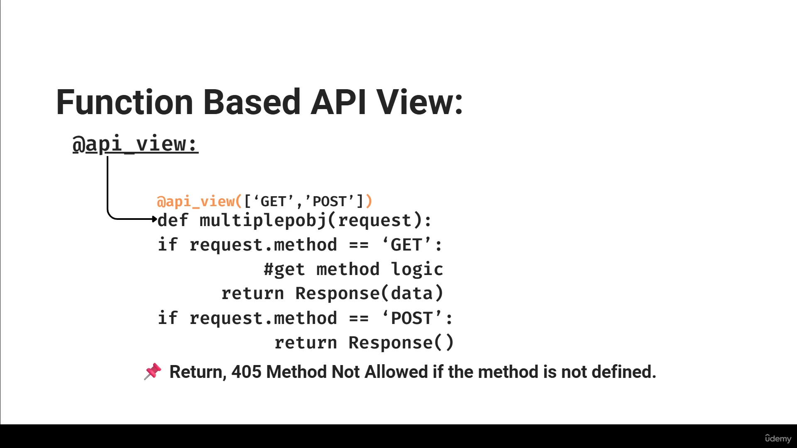

    - api/views.py:
        from rest_framework.decorators import api_view
        from rest_framework.response import Response

        @api_view(['GET', 'PUT', 'PATCH'])
        def single_object_view(request, id):
            data = get_object_or_404(Person, id=id)
            if request.method == "PUT":
                ...
                return Response({"updated": "success"}, status=status.HTTP_200_OK)
            if request.method == "PATCH":
                ...
            if request.method == "GET":
                serializer = PersonModelSerializer(data)
                return Response(serializer.data)

        @api_view(['GET', 'POST'])
        def multiple_objects_view(request):
            if request.method == 'POST':
                ...
                return Response({"created": "success"}, status=status.HTTP_201_CREATED)
            if request.method == 'GET':
                data = Person.objects.all()
                serializer = PersonModelSerializer(data, many=True)
                return Response(serializer.data)
    - Changes compared to before:
        - @csrf_exempt removed -> @api_view; DRF views skip Django's CSRF
          check (unless logged in with a session).
        - JsonResponse -> Response (DRF). Response renders the data itself,
          a list needs no safe=False.
        - GET is its own if block now, like PUT / PATCH / POST.
    - Test: PUT to /multipleobj/ (only GET and POST allowed there):
        curl --location --request PUT 'http://127.0.0.1:8000/multipleobj/' \
        --header 'Content-Type: application/json' \
        --data '{
            "name": "Sachin max"
        }'
      -> 405 {"detail": "Method \"PUT\" not allowed."}
      @api_view rejects the method before our code runs. (Without it, the
      view would have returned None -> 500.)

## Request and Response classes (course slides)

    - Request: DRF's Request class extends Django's HttpRequest. It parses
      JSON and other formats automatically, so they can be handled just like
      regular form data.
        - request.data:
            - all parsed content, file and non-file inputs
            - works for request bodies beyond POST: PUT and PATCH too
            - flexible parsing, JSON as well, not just form data
        - request.query_params:
            - a clearer name for request.GET (the ?key=value part of the
              URL), recommended because any HTTP method can have query
              parameters, not just GET.
    - Response:
        - Rendering: the Response class converts Python data (dicts, lists)
          into a rendered format like JSON or XML with the right renderer
          before sending it to the client.
        - Content negotiation: decides how the response data is formatted,
          based on what the client asks for.

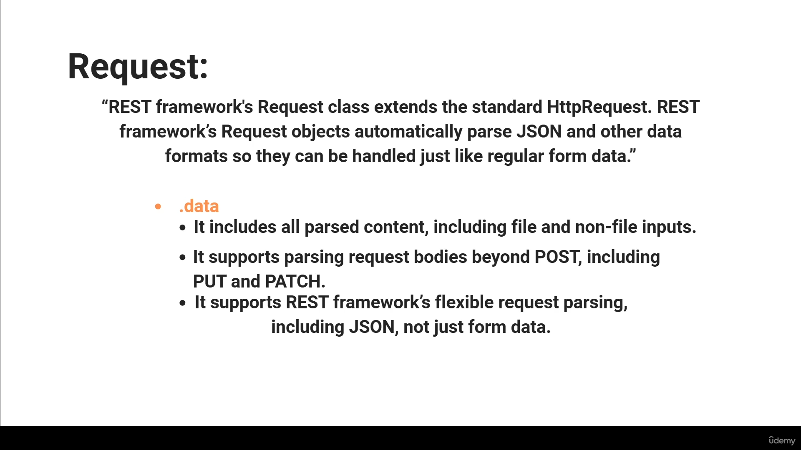

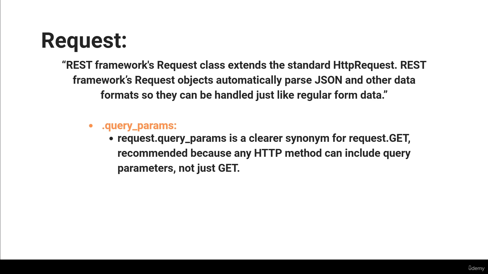

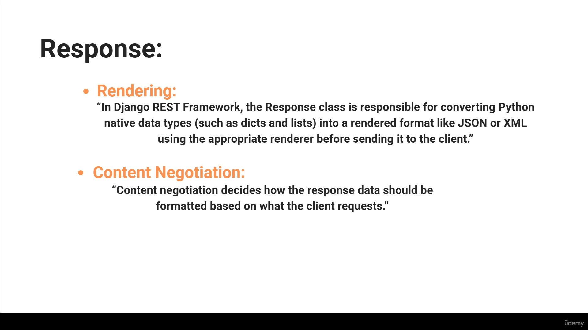

## request.data instead of parsing by hand

    - api/views.py, PUT, PATCH and POST: the 2-3 parsing lines are replaced
      by one line:
        before:
            stream = io.BytesIO(request.body)
            parsed_data = JSONParser().parse(stream)
        now:
            parsed_data = request.data
    - With @api_view, request is DRF's Request, so request.data is already
      the parsed Python dict. DRF does the BytesIO + JSONParser part for us
      ("manual parsing is only for learning", from the de-serialization
      slide).

## Content negotiation (course slides + DRF docs)

    - Content negotiation = sending the response in the format the client
      asks for.
    - Flow:
        Client -> Request (Accept: application/json)
        -> DRF checks the Accept header against the renderers
        -> picks a renderer (JSONRenderer etc.)
        -> View returns Response()
        -> final content negotiation -> the renderer renders the data
        -> Response -> Client

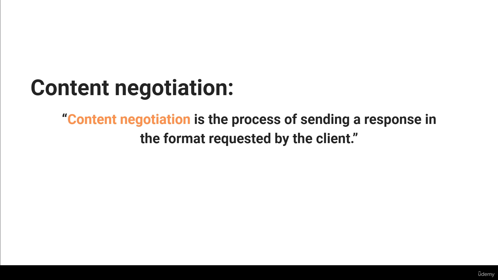

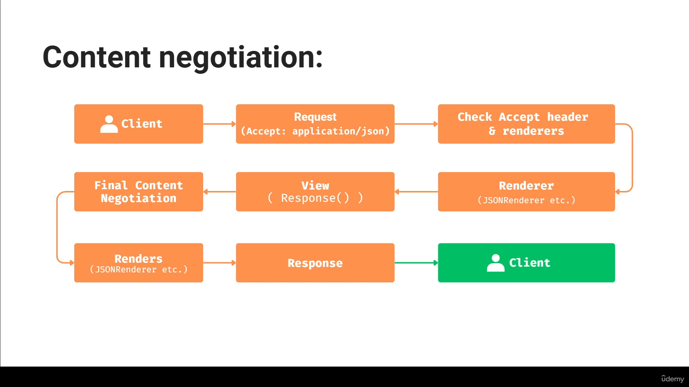

    - DRF docs, Settings -> API policy settings -> DEFAULT_RENDERER_CLASSES
      (applies to every APIView class-based view and @api_view function
      view). Default:
        [
            'rest_framework.renderers.JSONRenderer',
            'rest_framework.renderers.BrowsableAPIRenderer',
        ]
      JSONRenderer is first -> the default when the client accepts anything.
      BrowsableAPIRenderer -> the HTML page DRF shows in the browser.
      DEFAULT_PARSER_CLASSES = the parsers behind request.data.
      https://www.django-rest-framework.org/api-guide/settings/

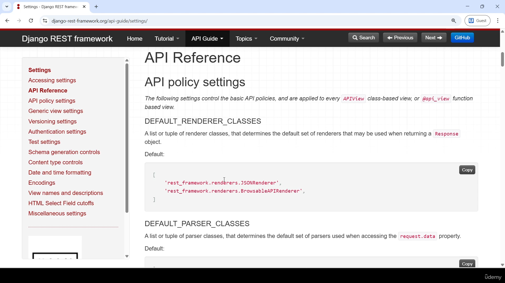

    - api/views.py, GET in multiple_objects_view prints which renderer DRF
      picked:
        if request.method == 'GET':
            print(request.accepted_renderer)
            ...
    - Request from Postman (as cURL):
        curl --location 'http://127.0.0.1:8000/multipleobj/' \
        --header 'Accept: text/html' \
        --header 'Cookie: csrftoken=...'
      Terminal:
        <rest_framework.renderers.JSONRenderer object at 0x0000019A4C832120>
        [08/Nov/2026 18:30:30] "GET /multipleobj/ HTTP/1.1" 200 211
      JSONRenderer and 211 bytes (the JSON list) -> the default renderer.
    - Checked with the Django test client, same view, different Accept:
        Accept: text/html        -> BrowsableAPIRenderer, 7535 bytes (HTML page)
        Accept: application/json -> JSONRenderer, 211 bytes
        Accept: */*              -> JSONRenderer, 211 bytes (the default)
    - Note: Response(..., content_type='application/json') in the view sets
      the Content-Type header to application/json even when the
      BrowsableAPIRenderer renders HTML.

## Raise exception argument: is_valid(raise_exception=True)

    - api/views.py, POST, PUT and PATCH: the if / else around is_valid()
      replaced by one line:
        before:
            if serializer.is_valid():
                serializer.save()
                return Response({"created": "success"}, status=status.HTTP_201_CREATED)
            else:
                return Response(serializer.errors, status=status.HTTP_400_BAD_REQUEST)
        now:
            serializer.is_valid(raise_exception=True)
            serializer.save()
            return Response({"created": "success"}, status=status.HTTP_201_CREATED)
    - Invalid data -> is_valid raises a ValidationError, DRF catches it and
      sends 400 with serializer.errors by itself. The lines after it only run
      when the data is valid.
    - POST with only a name:
        curl --location 'http://127.0.0.1:8000/multipleobj/' \
        --header 'Content-Type: application/json' \
        --data '{
            "name": "Add your name in the body"
        }'
      -> 400
        {
            "age": ["This field is required."],
            "city": ["This field is required."]
        }
    - Checked PUT and PATCH the same way (test client, rolled back):
        PUT   /singleobj/1/ {"name": "x"}    -> 400 age and city required
        PATCH /singleobj/1/ {"age": "abc"}   -> 400 "A valid integer is required."
        PATCH /singleobj/1/ {"name": "ok"}   -> 200 {"updated": "success"}

## Browsable API

    - Already on by default: BrowsableAPIRenderer is in the default
      DEFAULT_RENDERER_CLASSES. Needed for it: 'rest_framework' in
      INSTALLED_APPS (its templates and CSS), views with @api_view and
      DRF's Response.
    - Problem: Response(serializer.data, content_type='application/json')
      in the list view. For a browser, DRF renders the HTML page, but the
      header said application/json -> the browser shows raw HTML text.
    - Fix, api/views.py: content_type='application/json' removed from every
      Response(...), DRF sets the Content-Type from the chosen renderer:
        return Response(serializer.data)
        return Response({"created": "success"}, status=status.HTTP_201_CREATED)
    - peoplehub/urls.py, log in / log out links on the browsable page:
        path('api-auth/', include('rest_framework.urls')),
      Adds /api-auth/login/ and /api-auth/logout/. The browsable page then
      shows "Log in" top right; after logging in with a Django user (e.g.
      admin) it shows the username with "Log out". The browser then sends
      the session cookie, which matters once views need a logged-in user
      (permissions). Only for the browser, Postman / frontends log in
      differently.
    - Checked:
        /multipleobj/   Accept text/html        -> 200 text/html (browsable page)
        /multipleobj/   Accept application/json -> 200 application/json
        /singleobj/1/   Accept text/html        -> 200 text/html
        /api-auth/login/                        -> 200 login page
    - http://127.0.0.1:8000/multipleobj/ in the browser: the "Multiple Objects
      View" page with
        - the request line: GET /multipleobj/
        - the response: HTTP 200 OK, Allow: GET, OPTIONS, POST,
          Content-Type: application/json, Vary: Accept, and the JSON list
        - OPTIONS and GET buttons (GET dropdown: json / api format)
        - a form at the bottom (Media type + Content) to POST a new Person
        - "admin" top right = logged in as the admin user
      Page title "Multiple Objects View" comes from the function name
      multiple_objects_view.

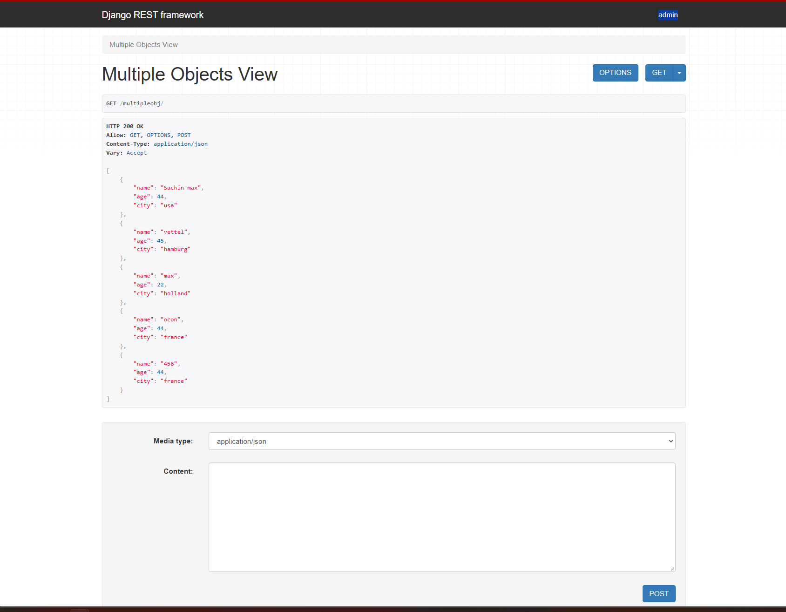

## Class based API views: APIView (course slide)

    - APIView subclasses Django's View class:
        - handler methods get DRF's Request instead of Django's HttpRequest
        - handlers return Response; the view does content negotiation and
          rendering
        - any APIException is caught and turned into the right response
    - Each HTTP method has its own handler method, the request is dispatched
      to the matching one (.get(), .post(), ...).
    - Undefined HTTP methods return 405 Method Not Allowed automatically.
        class MultipleObj(APIView):
            def get(self, request):
                return Response()
            def post(self, request):
                return Response()

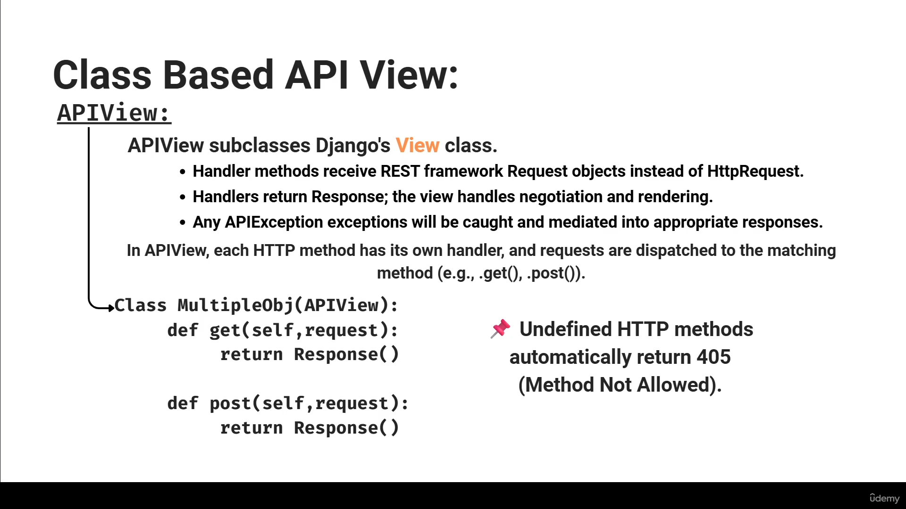

## SingleObjectView and MultipleObjectsView (APIView)

    - api/views.py, the same logic as the function views, one method per
      HTTP method instead of if request.method == ...:
        from rest_framework.views import APIView

        class SingleObjectView(APIView):
            def get(self, request, id):
                data = get_object_or_404(Person, id=id)
                serializer = PersonModelSerializer(data)
                return Response(serializer.data)

            def put(self, request, id):
                data = get_object_or_404(Person, id=id)
                serializer = PersonModelSerializer(data, data=request.data)
                serializer.is_valid(raise_exception=True)
                serializer.save()
                return Response({"updated": "success"}, status=status.HTTP_200_OK)

            def patch(self, request, id):
                ...same as put, with partial=True

        class MultipleObjectsView(APIView):
            def get(self, request):
                data = Person.objects.all()
                serializer = PersonModelSerializer(data, many=True)
                return Response(serializer.data)

            def post(self, request):
                serializer = PersonModelSerializer(data=request.data)
                serializer.is_valid(raise_exception=True)
                serializer.save()
                return Response({"created": "success"}, status=status.HTTP_201_CREATED)
    - Each method gets the id from the URL as a parameter (def get(self,
      request, id)), so get_object_or_404 is in every method.
    - No @api_view(['GET', ...]) list needed: the allowed methods are the
      methods the class has.
    - api/urls.py, class views need .as_view():
        path('singleobj/<int:id>/', views.SingleObjectView.as_view(), name='single_object_view'),
        path('multipleobj/', views.MultipleObjectsView.as_view(), name='multiple_objects_view'),
    - The old function views are still in views.py, but no URL uses them.
    - Checked (test client, rolled back):
        GET    /singleobj/1/   -> 200 the Person as JSON
        GET    /singleobj/22/  -> 404 {"detail": "No Person matches the given query."}
        GET    /multipleobj/   -> 200 the list
        PATCH  /singleobj/1/   -> 200 {"updated": "success"}
        PUT    /singleobj/1/ (only name) -> 400 age and city required
        POST   /multipleobj/   -> 201 {"created": "success"}
        PUT    /multipleobj/   -> 405 Method "PUT" not allowed (no put())
        DELETE /singleobj/1/   -> 405 Method "DELETE" not allowed (no delete())
      The 404 is JSON: APIView turns Django's Http404 into a DRF response
      (@api_view does the same, it builds an APIView behind the scenes).

## GenericAPIView (course slide)

    - GenericAPIView extends APIView and adds common features for standard
      list and detail views.
    - Attributes:
        queryset         -> the queryset used to return objects from this view
        serializer_class -> the serializer used to validate input, convert
                            input data and serialize output data
        class MultipleObj(GenericAPIView):
            queryset = Person.objects.all()
            serializer_class = PersonSerializer

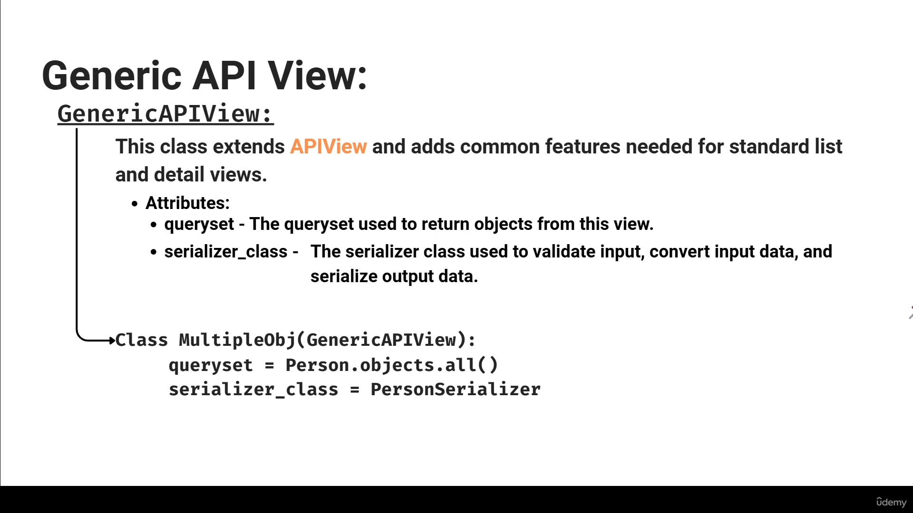

## SingleObjectGenericView and MultipleObjectsGenericView

    - api/views.py:
        from rest_framework.generics import GenericAPIView

        class SingleObjectGenericView(GenericAPIView):
            queryset = Person.objects.all()
            serializer_class = PersonModelSerializer
            lookup_field = 'id'

            def get(self, request, id):
                data = self.get_object()
                serializer = self.get_serializer(data)
                return Response(serializer.data)

            def put(self, request, id):
                data = self.get_object()
                serializer = self.get_serializer(data, data=request.data)
                serializer.is_valid(raise_exception=True)
                serializer.save()
                return Response({"updated": "success"}, status=status.HTTP_200_OK)

            def patch(self, request, id):
                ...same as put, with partial=True

        class MultipleObjectsGenericView(GenericAPIView):
            queryset = Person.objects.all()
            serializer_class = PersonModelSerializer

            def get(self, request):
                data = self.get_queryset()
                serializer = self.get_serializer(data, many=True)
                return Response(serializer.data)

            def post(self, request):
                serializer = self.get_serializer(data=request.data)
                serializer.is_valid(raise_exception=True)
                serializer.save()
                return Response({"created": "success"}, status=status.HTTP_201_CREATED)
    - Compared to APIView:
        Person.objects.all()             -> self.get_queryset()   (from queryset)
        get_object_or_404(Person, id=id) -> self.get_object()     (404 by itself)
        PersonModelSerializer(...)       -> self.get_serializer(...) (from serializer_class)
      Model and serializer are set once at the top of the class.
    - lookup_field = 'id': get_object() looks the object up by this field,
      with the value from the URL kwarg of the same name (<int:id>). The
      default is 'pk' -> with <int:id> in the URL and no lookup_field it
      wouldn't find the id.
    - api/urls.py now points to the generic views:
        path('singleobj/<int:id>/', views.SingleObjectGenericView.as_view(), name='single_object_view'),
        path('multipleobj/', views.MultipleObjectsGenericView.as_view(), name='multiple_objects_view'),
      The APIView classes and the function views stay in views.py, unused.
    - Typo fixed: from rest_framework.views import APIView' (stray quote,
      broke the file) -> APIView.
    - Checked (test client, rolled back):
        GET   /singleobj/1/   -> 200
        GET   /singleobj/22/  -> 404 {"detail": "No Person matches the given query."}
        GET   /multipleobj/   -> 200 the list
        PATCH /singleobj/1/   -> 200 {"updated": "success"}
        PUT   /singleobj/1/ (only name) -> 400 age and city required
        POST  /multipleobj/   -> 201 {"created": "success"}
        PUT   /multipleobj/   -> 405
        /multipleobj/ in the browser -> 200 text/html (browsable page)

## Mixins (course slide)

    - Mixin classes provide actions that define basic view behavior. They
      give action methods instead of handlers like .get() or .post(), which
      makes the behavior flexible and reusable.
        CreateModelMixin   -> create()                  returns the newly created object
        ListModelMixin     -> list()                    returns a list of objects
        RetrieveModelMixin -> retrieve()                returns a single object
        UpdateModelMixin   -> update() / partial_update() returns the updated object
        DestroyModelMixin  -> destroy()                 deletes the object, returns no content

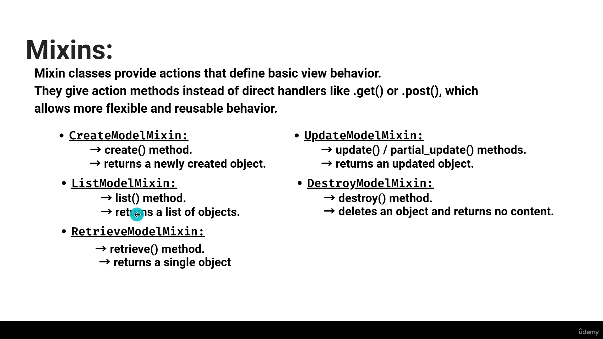

## Generic views with mixins

    - api/views.py:
        from rest_framework.mixins import ListModelMixin, CreateModelMixin, \
            RetrieveModelMixin, UpdateModelMixin, DestroyModelMixin

        class SingleObjectGenericView(RetrieveModelMixin, UpdateModelMixin,
                                      DestroyModelMixin, GenericAPIView):
            queryset = Person.objects.all()
            serializer_class = PersonModelSerializer
            lookup_field = 'id'

            def get(self, request, *args, **kwargs):
                return self.retrieve(request, *args, **kwargs)
            def put(self, request, *args, **kwargs):
                return self.update(request, *args, **kwargs)
            def patch(self, request, *args, **kwargs):
                return self.partial_update(request, *args, **kwargs)
            def delete(self, request, *args, **kwargs):
                return self.destroy(request, *args, **kwargs)

        class MultipleObjectsGenericView(CreateModelMixin, ListModelMixin, GenericAPIView):
            queryset = Person.objects.all()
            serializer_class = PersonModelSerializer

            def get(self, request, *args, **kwargs):
                return self.list(request, *args, **kwargs)
            def post(self, request, *args, **kwargs):
                return self.create(request, *args, **kwargs)
    - Each handler is one line: it hands the request to the mixin's action.
      get_object, get_serializer, is_valid(raise_exception=True), save and the
      Response are all inside the mixin.
    - The mixins come before GenericAPIView in the class list; the mixins use
      queryset / serializer_class / get_object() from GenericAPIView.
    - *args, **kwargs pass the URL kwargs (id) on to the mixin, get_object()
      reads id from there (lookup_field = 'id').
    - New: delete() with DestroyModelMixin -> DELETE /singleobj/<id>/ works.
    - Responses changed: the mixins return the object's data instead of
      {"updated": "success"} / {"created": "success"}.
    - Checked (test client, rolled back):
        GET    /singleobj/1/   -> 200 {"name": "Sachin max", "age": 44, "city": "usa"}
        GET    /singleobj/22/  -> 404
        GET    /multipleobj/   -> 200 the list
        PATCH  /singleobj/1/ {"name": "ok"}         -> 200 {"name": "ok", "age": 44, "city": "usa"}
        PUT    /singleobj/1/ {"name": "x"}          -> 400 age and city required
        PUT    /singleobj/1/ (all 3 fields)         -> 200 the updated Person
        POST   /multipleobj/ (all 3 fields)         -> 201 the new Person
        POST   /multipleobj/ {"name": "t"}          -> 400 age and city required
        DELETE /singleobj/5/   -> 204 (empty body), then GET /singleobj/5/ -> 404
        PUT    /multipleobj/   -> 405

## Browsable API: the HTML form appears with the generic view

    - /multipleobj/ in the browser with MultipleObjectsGenericView: next to
      "Raw data" there is now an "HTML form" tab with Name, Age and City
      inputs and a POST button.
    - Why: the browsable API builds the form from the view's serializer. A
      GenericAPIView has serializer_class (PersonModelSerializer), so DRF
      knows the fields and makes one input per field. The APIView /
      @api_view versions had no serializer_class -> only the raw form
      (Media type + Content, type the JSON by hand), see the earlier
      screenshot.
    - Other differences on the page:
        - Title "Multiple Objects Generic" comes from the class name
          MultipleObjectsGenericView (the "View" at the end is dropped).
        - Allow: GET, POST, HEAD, OPTIONS -> HEAD is added automatically
          for a class with get().

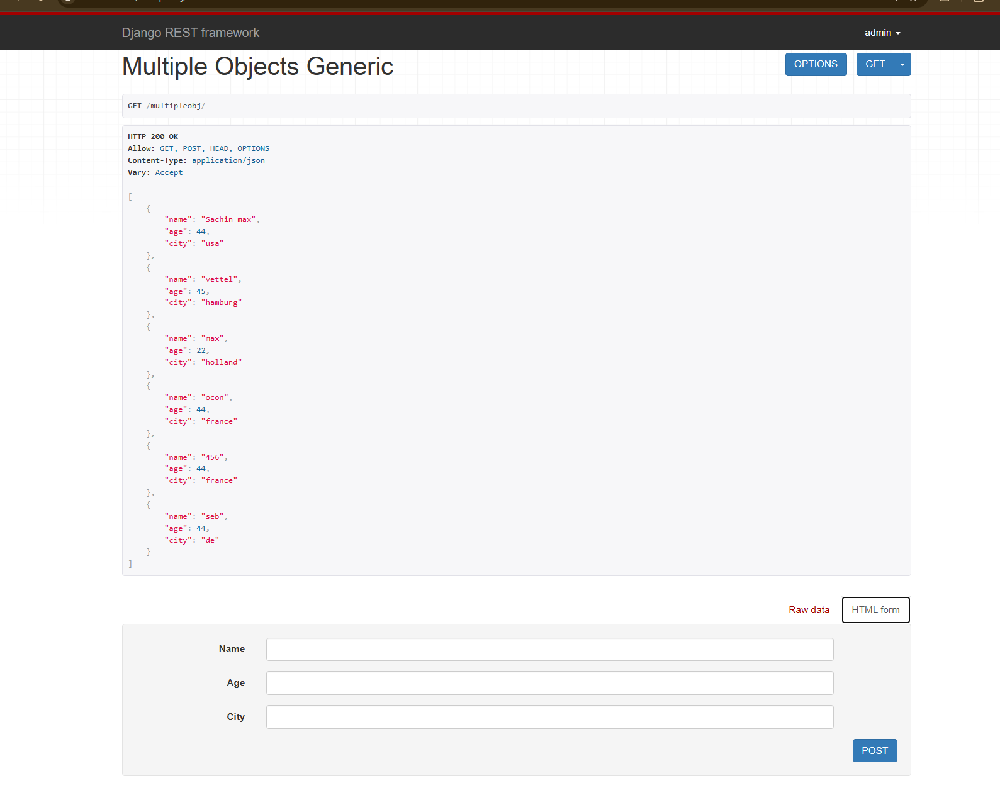

## <int:pk> instead of <int:id>: no lookup_field needed

    - get_object() looks up the object by lookup_field, default 'pk', with
      the value from the URL kwarg of the same name.
    - api/urls.py:
        path('singleobj/<int:pk>/', views.SingleObjectGenericView.as_view(), name='single_object_view'),
    - api/views.py, SingleObjectGenericView: lookup_field = 'id' removed.
      The methods stay the same, **kwargs passes pk on to get_object().
    - pk = primary key, whatever the model's primary key field is called.
      Person uses the automatic id field -> pk and id are the same value,
      /singleobj/1/ finds the same Person.
    - The old function / APIView versions still take id as a parameter,
      fine because no URL uses them.
    - Checked (test client, rolled back):
        GET    /singleobj/1/  -> 200
        GET    /singleobj/22/ -> 404
        PATCH  /singleobj/1/  -> 200
        DELETE /singleobj/5/  -> 204

## Concrete API views: ListCreateAPIView + RetrieveUpdateDestroyAPIView

    - Concrete generic views = GenericAPIView + the mixins + the one-line
      get() / post() / put() / patch() / delete() methods, already put
      together by DRF. Only queryset and serializer_class are left to write.
    - api/views.py:
        from rest_framework.generics import GenericAPIView, ListCreateAPIView, \
            RetrieveUpdateDestroyAPIView

        class SingleObjectConcreteView(RetrieveUpdateDestroyAPIView):
            queryset = Person.objects.all()
            serializer_class = PersonModelSerializer

        class MultipleObjectsConcreteView(ListCreateAPIView):
            queryset = Person.objects.all()
            serializer_class = PersonModelSerializer
    - The name says which actions the view has:
        ListCreateAPIView            -> GET (list) + POST (create)
        RetrieveUpdateDestroyAPIView -> GET (retrieve) + PUT / PATCH (update)
                                        + DELETE (destroy)
      Other concrete views: CreateAPIView, ListAPIView, RetrieveAPIView,
      UpdateAPIView, DestroyAPIView, RetrieveUpdateAPIView,
      RetrieveDestroyAPIView.
    - Same evolution, the view for one Person:
        @api_view function -> if request.method == ... blocks
        APIView            -> get() / put() / patch() methods, code by hand
        GenericAPIView     -> queryset + serializer_class, get_object(), get_serializer()
        + mixins           -> one-line methods: return self.retrieve(...)
        concrete view      -> 2 lines, no methods at all
    - api/urls.py now points to the concrete views:
        path('singleobj/<int:pk>/', views.SingleObjectConcreteView.as_view(), name='single_object_view'),
        path('multipleobj/', views.MultipleObjectsConcreteView.as_view(), name='multiple_objects_view'),
      <int:pk> works without lookup_field (default 'pk').
    - Checked (test client, rolled back):
        GET    /singleobj/1/   -> 200   Allow: GET, PUT, PATCH, DELETE, HEAD, OPTIONS
        GET    /singleobj/22/  -> 404
        GET    /multipleobj/   -> 200   Allow: GET, POST, HEAD, OPTIONS
        PATCH  /singleobj/1/   -> 200 the updated Person
        PUT    /singleobj/1/ (only name) -> 400 age and city required
        POST   /multipleobj/   -> 201 the new Person
        DELETE /singleobj/5/   -> 204
        PUT    /multipleobj/   -> 405
        browsable page /multipleobj/ -> 200, with the HTML form

## Authentication and token-based authentication (course slides)

    - Authentication = verifying who a user is, usually by checking
      credentials like a username / password or a token, before allowing
      access to a system.
    - Token-based authentication = the user proves their identity once with
      credentials, and after that on every request with a token instead of
      the password.
    - Login phase:
        1. Client -> POST /api/login/ {"username": "simar", "password": "12345"}
        2. DRF / Django verifies the credentials: finds the user by username,
           compares the passwords.
        3. A token is created (or fetched if the user already has one):
           User: simar, Token: a9f4c83d7f1e2b... (a random string)
        4. The token is returned to the client: {"token": "a9f4c83d7f1e2b..."}

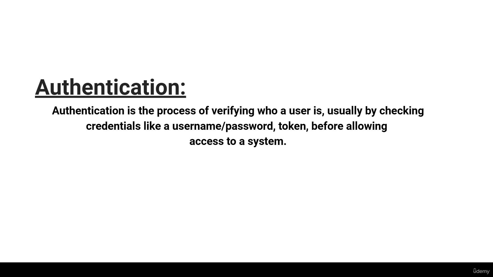

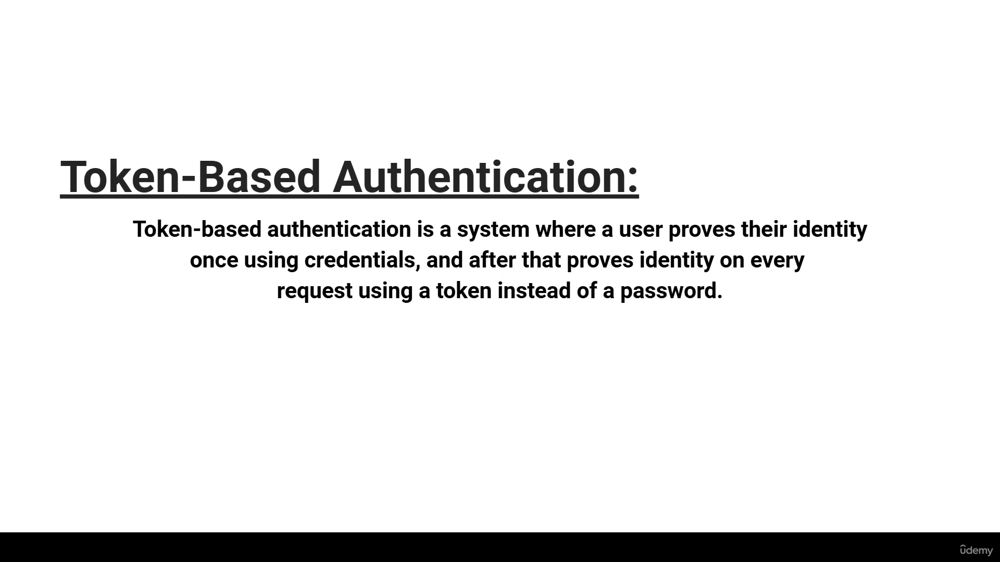

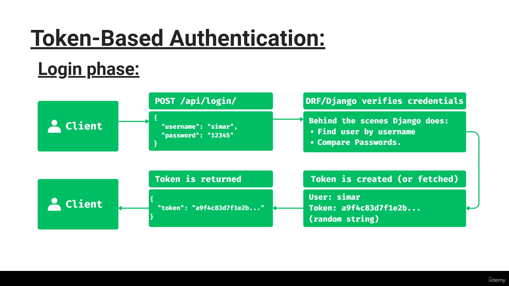

## Token authentication: user_auth app, login view, TokenAuthentication

    - peoplehub/settings.py, INSTALLED_APPS:
        'rest_framework.authtoken',   # the Token model (one token per user)
        'user_auth'
      authtoken has its own table, so: python manage.py migrate
      The admin then shows AUTH TOKEN -> Tokens.
    - Error: python3 .\manage.py startapp user_auth (inside the drf venv)
        ModuleNotFoundError: No module named 'rest_framework'
      The traceback paths were the global Python
      (AppData\Roaming\Python\Python314\site-packages\django).
      On Windows the venv only has python.exe (no python3.exe), so python3
      runs the global Python, which has Django but not DRF.
      Fix: python .\manage.py startapp user_auth

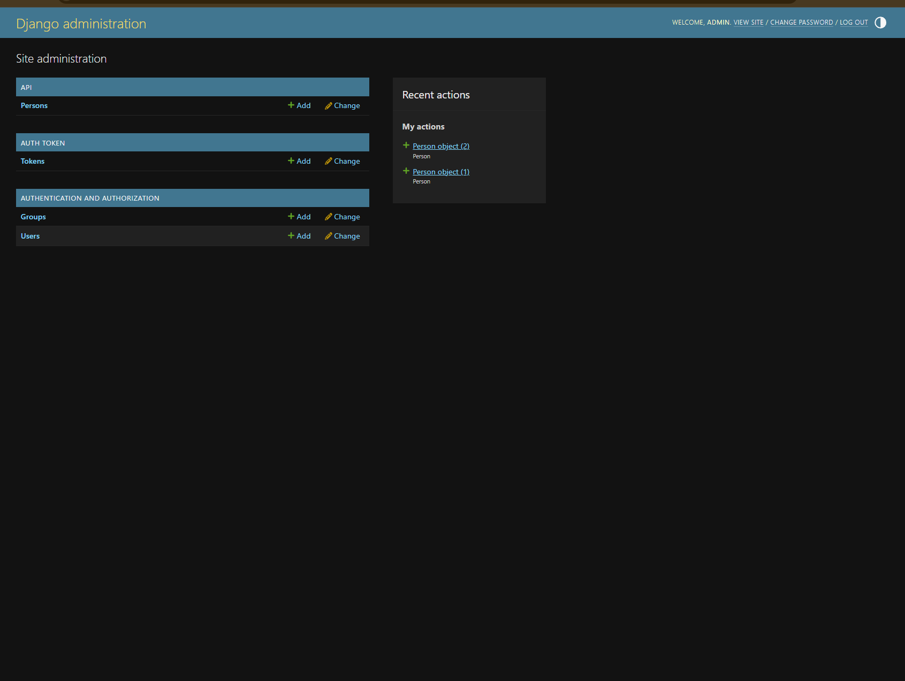

    - user_auth/views.py:
        from rest_framework.views import APIView, Response
        from django.contrib.auth import authenticate
        from rest_framework.authtoken.models import Token
        from rest_framework import status

        class LoginView(APIView):
            def post(self, request):
                username = request.data.get('username')
                password = request.data.get('password')

                user = authenticate(request, username=username, password=password)
                if user is not None:
                    token, created = Token.objects.get_or_create(user=user)
                    return Response({'token': token.key}, status=200)

                return Response({'error': 'Invalid credentials'}, status=status.HTTP_401_UNAUTHORIZED)
      authenticate() returns the User if username / password match, else None.
      get_or_create() returns the user's existing token, or makes one.
    - user_auth/urls.py:
        urlpatterns = [path('login/', views.LoginView.as_view(), name='login'),]
    - peoplehub/urls.py:
        path('auth/', include('user_auth.urls')),
    - Login (POST /auth/login/):
        curl --location 'http://127.0.0.1:8000/auth/login/' \
        --header 'Content-Type: application/json' \
        --data '{"username": "admin", "password": "..."}'
      Response:
        {"token": "..."}
    - api/views.py, the list view reads the token:
        from rest_framework.authentication import TokenAuthentication

        class MultipleObjectsConcreteView(ListCreateAPIView):
            authentication_classes = [TokenAuthentication]
            queryset = Person.objects.all()
            serializer_class = PersonModelSerializer

            def get(self, request, *args, **kwargs):
                print("************************************")
                print("user is", request.user)
                response = super().get(request, *args, **kwargs)
                return response
      The token goes in a header on every request:
        Authorization: Token <token>
    - authentication_classes only says HOW the user is identified. It does
      not make login required (that is permission_classes). With no token
      the request still works and request.user is AnonymousUser.
    - "user is AnonymousUser" even though the token was passed, the reasons:
        1. curl with --data and no --request GET is a POST. post() -> create(),
           the print in get() never runs.
        2. Browser refresh of /multipleobj/: a browser never sends an
           Authorization: Token header. Being logged in through /admin/ or
           /api-auth/ is a session cookie, read by SessionAuthentication,
           which is not in authentication_classes.
        3. Postman: the Authorization tab was set (inherited from the
           collection). Postman's warning on the hand-written header:
             "This is a duplicate header and will be overridden by the
              Authorization header generated by Postman."
           So the token header never reached the server.
           Fix: Authorization tab -> No Auth, keep the header in Headers.
    - Checks against the running server:
        Authorization: Token abc        -> 401 {"detail": "Invalid token."}
        Authorization: Token <real one> -> 200, terminal: user is admin
        PowerShell: curl.exe http://127.0.0.1:8000/multipleobj/ -H "Authorization: Token <token>"
          -> user is admin
      Wrong token = 401, no token = AnonymousUser. Postman worked after
      the Authorization tab was set to No Auth.

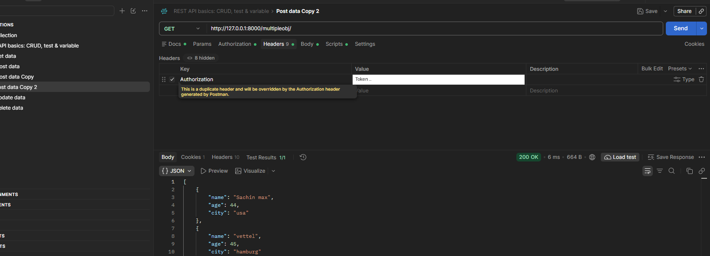

## permission_classes = [IsAuthenticated]: no token, no access

    - Authentication = who is the user. No token -> AnonymousUser, and the
      request still goes on.
      Permission = is this user allowed. This is the part that blocks.
      No permission_classes -> DRF's default AllowAny, so AnonymousUser
      still got the list.
    - Course slides: permissions define whether an authenticated (or
      unauthenticated) request is allowed to perform a specific action on a
      view or an object.
        AllowAny                   everyone can access
        IsAuthenticated            only logged-in users
        IsAdminUser                only staff users
        IsAuthenticatedOrReadOnly  anyone can read, only authenticated can write
      Order: Request -> Authentication (e.g. TokenAuthentication)
                     -> Permissions (e.g. IsAuthenticated) -> View code

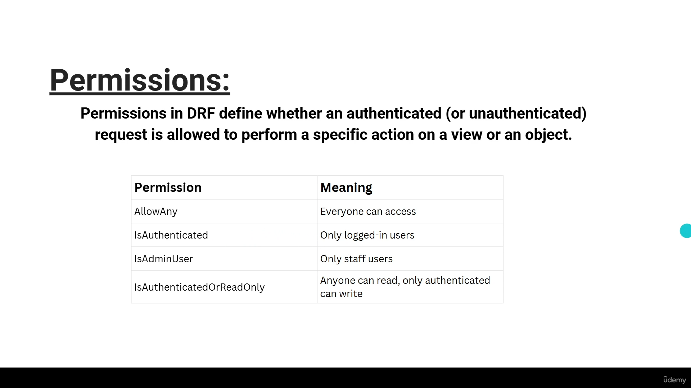

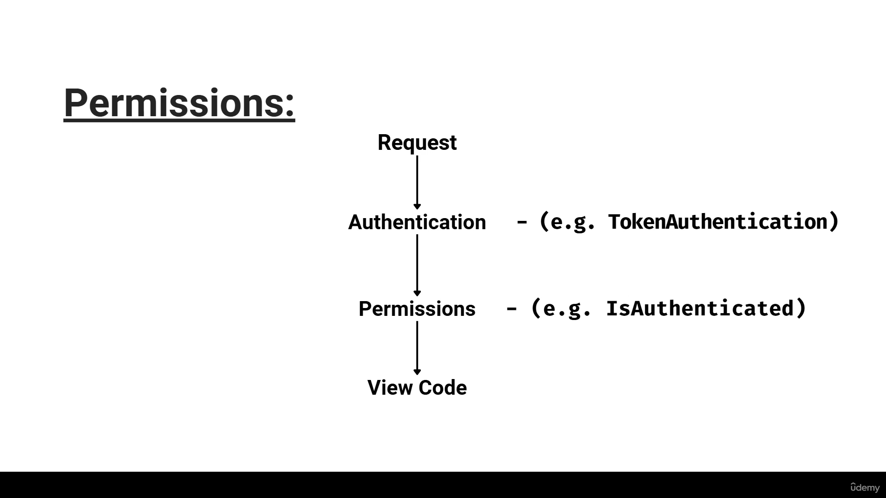

    - api/views.py:
        from rest_framework.permissions import IsAuthenticated

        class MultipleObjectsConcreteView(ListCreateAPIView):
            authentication_classes = [TokenAuthentication]  # Who is the user: read the token from the Authorization header
            permission_classes = [IsAuthenticated]  # No valid token -> 401, the view does not run
            queryset = Person.objects.all()
            serializer_class = PersonModelSerializer
    - Typo first: permissions_classes = [IsAuthenticated]
      DRF only reads permission_classes. The misspelled name is just an
      unused class attribute: no error, and the view stays AllowAny.
    - Checked against the running server, GET /multipleobj/:
        no token          -> 401 {"detail": "Authentication credentials were not provided."}
        Token abc         -> 401 {"detail": "Invalid token."}
        the real token    -> 200, the list (terminal: user is admin)
      Browser refresh -> 401 too (no token sent).
      /singleobj/<pk>/ has no permission_classes, still open.
    - peoplehub/settings.py, the project-wide version (every view), added
      commented out:
        # REST_FRAMEWORK = {
        #     'DEFAULT_AUTHENTICATION_CLASSES': [
        #         'rest_framework.authentication.TokenAuthentication',
        #     ],
        #     'DEFAULT_PERMISSION_CLASSES': [
        #         'rest_framework.permissions.IsAuthenticated',
        #     ],
        # }

## Global REST_FRAMEWORK settings, LoginView opened up

    - peoplehub/settings.py, the block is now active, so EVERY DRF view
      uses TokenAuthentication + IsAuthenticated:
        REST_FRAMEWORK = {
            'DEFAULT_AUTHENTICATION_CLASSES': [
                'rest_framework.authentication.TokenAuthentication',
            ],
            'DEFAULT_PERMISSION_CLASSES': [
                'rest_framework.permissions.IsAuthenticated',
            ],
        }
    - api/views.py, the per-view lines are no longer needed, commented out:
        # authentication_classes = [TokenAuthentication]
        # permission_classes = [IsAuthenticated]
    - Checked (test client):
        /multipleobj/  no token -> 401   token -> 200
        /singleobj/1/  no token -> 401   token -> 200  (now protected too)
        POST /auth/login/       -> 401 {"detail": "Authentication credentials were not provided."}
    - Problem: LoginView is a DRF APIView too, so it got the global
      IsAuthenticated. Logging in needed a valid token of any existing
      user, so a new user could never get one.
    - Fix, user_auth/views.py (a setting on the view overrides settings.py):
        class LoginView(APIView):
            permission_classes = []  # Overrides the global IsAuthenticated: anyone can try to log in
            authentication_classes = []  # No authentication required for login
      permission_classes = []      -> no checks, same as [AllowAny]
      authentication_classes = []  -> the token header is not read at all,
                                      so even a wrong / old token can't break login
    - Checked (test client):
        login, no token          -> reaches the view, {"error": "Invalid credentials"} (wrong password)
        login, Token abc         -> same, the bad token is ignored
        /multipleobj/, no token  -> 401
    - The browsable API (browser, /api-auth/login/) gets 401 now: the
      browser can't send a token and SessionAuthentication is not in the
      defaults.

## Authentication class vs permission class

    - Authentication class = WHO are you?
        looks at the request (token header, session cookie)
        sets request.user (a real user, or AnonymousUser)
        bad token -> 401 "Invalid token."; no token is NOT a failure,
        just AnonymousUser
        e.g. TokenAuthentication, SessionAuthentication, BasicAuthentication
        setting: authentication_classes
    - Permission class = are you ALLOWED?
        looks at request.user (set by authentication), the method, the object
        allow or deny: 401 (not logged in) / 403 (logged in, not allowed)
        e.g. AllowAny, IsAuthenticated, IsAdminUser, IsAuthenticatedOrReadOnly
        setting: permission_classes
    - Order: Request -> Authentication -> Permission -> view code
    - Office building: authentication = the receptionist checking your ID
      card (no card -> "visitor"); permission = the door lock deciding if
      that person may enter the room.
    - Seen in this project:
        token auth only, no permission    -> no token = AnonymousUser, list still returned
        token auth + IsAuthenticated      -> no token = 401
        LoginView, both []                -> nobody identified, nothing checked, anyone gets in

## Login with obtain_auth_token, register and logout

    - user_auth/urls.py:
        from rest_framework.authtoken.views import obtain_auth_token

        urlpatterns = [
            path('login/', obtain_auth_token, name='login'),
            path('register/', views.RegisterView.as_view(), name='register'),
            path('logout/', views.LogoutView.as_view(), name='logout'),
        ]
      obtain_auth_token = DRF's built-in login view: POST username +
      password -> {"token": "..."}, the same job as our LoginView (which
      is still in views.py, no URL points to it now).
    - user_auth/serializers.py (new):
        from django.contrib.auth.models import User
        from rest_framework import serializers

        class RegisterSerializer(serializers.ModelSerializer):
            password = serializers.CharField(write_only=True)  # Accepted on input, never sent back in a response

            class Meta:
                model = User
                fields = ['username', 'password']

            def create(self, validated_data):
                # create_user() hashes the password; User.objects.create() would store it as plain text
                return User.objects.create_user(**validated_data)
      Why a serializer:
        is_valid() checks from the User model: fields present, username
          not taken, length / allowed characters.
        create_user() stores the password hashed (pbkdf2_sha256$...).
          A plain save would use objects.create() -> plain text, and
          login would never match.
        write_only=True -> the password is never in serializer.data.
    - user_auth/views.py:
        class RegisterView(APIView):
            permission_classes = []  # Overrides the global IsAuthenticated: anyone can register
            authentication_classes = []  # No token needed to register

            def post(self, request):
                serializer = RegisterSerializer(data=request.data)
                serializer.is_valid(raise_exception=True)  # 400 if username is taken / fields are missing
                user = serializer.save()  # Calls RegisterSerializer.create() -> create_user()
                token = Token.objects.create(user=user)  # New user, so a new token
                return Response({'token': token.key}, status=status.HTTP_201_CREATED)

        class LogoutView(APIView):
            # No overrides: the global TokenAuthentication + IsAuthenticated apply,
            # so only a request with a valid token gets here (no token -> 401)

            def post(self, request):
                request.user.auth_token.delete()  # Delete this user's token; it stops working at once
                return Response({'message': 'Logged out'}, status=status.HTTP_200_OK)
      Logout = delete the token. request.user is the user TokenAuthentication
      found from the header, auth_token is that user's Token row.
    - Checked (test client, rolled back):
        POST /auth/register/ {"username": "liam", "password": "..."}  -> 201 {"token": "..."}
        password in the DB                     -> pbkdf2_sha256$... (hashed)
        register liam again                    -> 400 {"username": ["A user with that username already exists."]}
        register without password              -> 400 {"password": ["This field is required."]}
        POST /auth/login/ as liam              -> 200, the same token
        GET /multipleobj/ with liam's token    -> 200
        POST /auth/logout/ no token            -> 401
        POST /auth/logout/ with the token      -> 200 {"message": "Logged out"}
        GET /multipleobj/ same token again     -> 401 {"detail": "Invalid token."}
        login again                            -> 200, a new token

## Helpful resources

    - Django docs:
        https://docs.djangoproject.com/en/6.1/
    - Django REST Framework (DRF) docs:
        https://www.django-rest-framework.org/
    - DRF serializer fields (CharField, IntegerField, ...):
        https://www.django-rest-framework.org/api-guide/fields/
