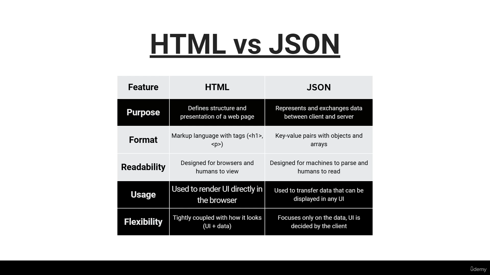
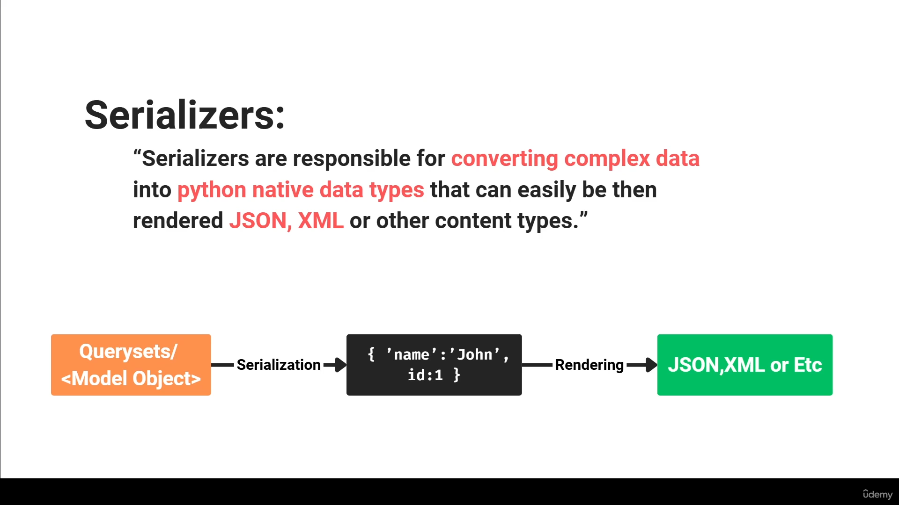
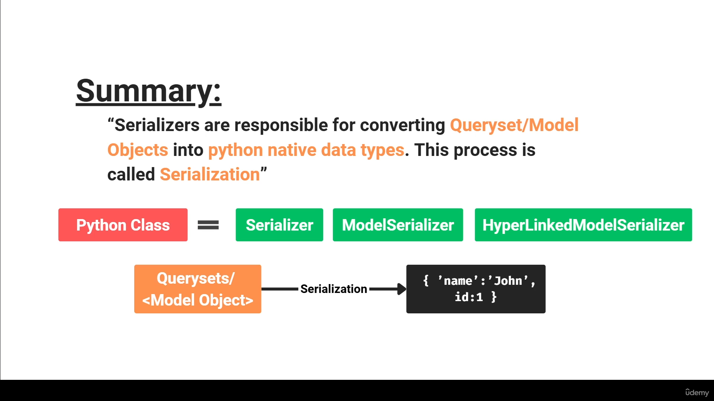

## Section 16 begins

## django-admin startproject peoplehub

    - New Django project "peoplehub" (inside django_complete/, next to mypage,
      monthly_challenges, book_store, feedback and my_site).
    - Generated with Django 6.1.2.
    - Makes a folder "peoplehub" containing:
        manage.py          -> tool to run project commands (runserver, migrate, startapp, ...)
        peoplehub/         -> project settings package
            __init__.py    -> marks the folder as a Python package
            settings.py    -> project configuration (installed apps, database, etc.)
            urls.py        -> main URL routes of the site
            asgi.py        -> entry point for async web servers
            wsgi.py        -> entry point for regular web servers
    - No app yet and no db.sqlite3 (it appears after the first migrate).

## HTML vs JSON (course slide)

    - Purpose:
        HTML -> defines the structure and presentation of a web page
        JSON -> represents and exchanges data between client and server
    - Format:
        HTML -> markup language with tags (<h1>, 
)
        JSON -> key-value pairs with objects and arrays
    - Readability:
        HTML -> designed for browsers and humans to view
        JSON -> designed for machines to parse and humans to read
    - Usage:
        HTML -> used to render the UI directly in the browser
        JSON -> used to transfer data that can be displayed in any UI
    - Flexibility:
        HTML -> tightly coupled with how it looks (UI + data)
        JSON -> only the data, the UI is decided by the client

## Virtual environment "drf" + pip install djangorestframework

    - Commands (PowerShell, inside peoplehub/):
        python3 -m venv drf              -> creates the venv folder drf/
        .\drf\Scripts\Activate.ps1       -> activates it, prompt shows (drf)
        pip install djangorestframework  -> installs DRF into the venv
    - Installed: djangorestframework 3.18.3, and Django 6.1.3 came with it
      (DRF needs Django, so pip pulled it in).
    - drf/ is not committed: venv creates its own drf/.gitignore with "*".

## python manage.py startapp api + INSTALLED_APPS

    - New app "api" (folder api/ with models.py, views.py, admin.py, apps.py,
      tests.py, migrations/). Files still empty (the default startapp code).
    - settings.py -> INSTALLED_APPS, added our app and DRF:
        INSTALLED_APPS = [
            ...
            'django.contrib.staticfiles',
            'api',
            'rest_framework',
        ]
    - The pip package is "djangorestframework" but the app name to add is
      'rest_framework' (the folder name in site-packages).
    - Typo fixed: 'django.contrib.staticfiles',, (two commas) -> one comma.

## Person model + migrate + admin

    - api/models.py:
        class Person(models.Model):
            name = models.CharField(max_length=100)
            age = models.PositiveIntegerField()
            city = models.CharField(max_length=100)
    - python manage.py makemigrations -> api/migrations/0001_initial.py
      python manage.py migrate         -> creates db.sqlite3 with the tables
    - python manage.py createsuperuser -> username admin.
    - First Person row added in the admin.
    - api/admin.py:
        class PersonAdmin(admin.ModelAdmin):
            list_display = ("name", "age", "city")

        admin.site.register(Person, PersonAdmin)
    - Problem: the admin list showed only "Person object (1)", not the fields.
        1. admin.site.register(Person) without PersonAdmin -> the class was
           never used. Fix: admin.site.register(Person, PersonAdmin).
        2. list_display = "__all__" is not allowed ("__all__" only works for
           fields in a ModelForm). Fix: list the field names one by one.

## Serializers (course slides)

    - Serializers convert complex data (querysets / model objects) into
      Python native data types, which can then be rendered as JSON, XML or
      other content types.
    - Two steps:
        querysets / model object --Serialization--> {'name': 'John', 'id': 1}
        {'name': 'John', 'id': 1} --Rendering--> JSON, XML, ...
    - Serialization = converting queryset / model objects into Python native
      data types.
    - A serializer is a Python class. Three kinds:
        Serializer, ModelSerializer, HyperlinkedModelSerializer

## Helpful resources

    - Django docs:
        https://docs.djangoproject.com/en/6.1/
    - Django REST Framework (DRF) docs:
        https://www.django-rest-framework.org/
