## Section 16 begins

## django-admin startproject peoplehub

    - New Django project "peoplehub" (inside django_complete/, next to mypage,
      monthly_challenges, book_store, feedback and my_site).
    - Generated with Django 6.1.2.
    - Makes a folder "peoplehub" containing:
        manage.py          -> tool to run project commands (runserver, migrate, startapp, ...)
        peoplehub/         -> project settings package
            __init__.py    -> marks the folder as a Python package
            settings.py    -> project configuration (installed apps, database, etc.)
            urls.py        -> main URL routes of the site
            asgi.py        -> entry point for async web servers
            wsgi.py        -> entry point for regular web servers
    - No app yet and no db.sqlite3 (it appears after the first migrate).

## HTML vs JSON (course slide)

    - Purpose:
        HTML -> defines the structure and presentation of a web page
        JSON -> represents and exchanges data between client and server
    - Format:
        HTML -> markup language with tags (<h1>, 
)
        JSON -> key-value pairs with objects and arrays
    - Readability:
        HTML -> designed for browsers and humans to view
        JSON -> designed for machines to parse and humans to read
    - Usage:
        HTML -> used to render the UI directly in the browser
        JSON -> used to transfer data that can be displayed in any UI
    - Flexibility:
        HTML -> tightly coupled with how it looks (UI + data)
        JSON -> only the data, the UI is decided by the client

## Virtual environment "drf" + pip install djangorestframework

    - Commands (PowerShell, inside peoplehub/):
        python3 -m venv drf              -> creates the venv folder drf/
        .\drf\Scripts\Activate.ps1       -> activates it, prompt shows (drf)
        pip install djangorestframework  -> installs DRF into the venv
    - Installed: djangorestframework 3.18.3, and Django 6.1.3 came with it
      (DRF needs Django, so pip pulled it in).
    - drf/ is not committed: venv creates its own drf/.gitignore with "*".

## python manage.py startapp api + INSTALLED_APPS

    - New app "api" (folder api/ with models.py, views.py, admin.py, apps.py,
      tests.py, migrations/). Files still empty (the default startapp code).
    - settings.py -> INSTALLED_APPS, added our app and DRF:
        INSTALLED_APPS = [
            ...
            'django.contrib.staticfiles',
            'api',
            'rest_framework',
        ]
    - The pip package is "djangorestframework" but the app name to add is
      'rest_framework' (the folder name in site-packages).
    - Typo fixed: 'django.contrib.staticfiles',, (two commas) -> one comma.

## Person model + migrate + admin

    - api/models.py:
        class Person(models.Model):
            name = models.CharField(max_length=100)
            age = models.PositiveIntegerField()
            city = models.CharField(max_length=100)
    - python manage.py makemigrations -> api/migrations/0001_initial.py
      python manage.py migrate         -> creates db.sqlite3 with the tables
    - python manage.py createsuperuser -> username admin.
    - First Person row added in the admin.
    - api/admin.py:
        class PersonAdmin(admin.ModelAdmin):
            list_display = ("name", "age", "city")

        admin.site.register(Person, PersonAdmin)
    - Problem: the admin list showed only "Person object (1)", not the fields.
        1. admin.site.register(Person) without PersonAdmin -> the class was
           never used. Fix: admin.site.register(Person, PersonAdmin).
        2. list_display = "__all__" is not allowed ("__all__" only works for
           fields in a ModelForm). Fix: list the field names one by one.

## Serializers (course slides)

    - Serializers convert complex data (querysets / model objects) into
      Python native data types, which can then be rendered as JSON, XML or
      other content types.
    - Two steps:
        querysets / model object --Serialization--> {'name': 'John', 'id': 1}
        {'name': 'John', 'id': 1} --Rendering--> JSON, XML, ...
    - Serialization = converting queryset / model objects into Python native
      data types.
    - A serializer is a Python class. Three kinds:
        Serializer, ModelSerializer, HyperlinkedModelSerializer

## First serializer: api/serializers.py (serializers.Serializer)

    - New file api/serializers.py:
        from rest_framework import serializers

        class PersonSerializer(serializers.Serializer):
            name = serializers.CharField(max_length=100)
            age = serializers.IntegerField()
            city = serializers.CharField(max_length=100)
    - With the plain Serializer class every field is written by hand, matching
      the Person model fields (name, age, city).

## Serialization: 3 steps (course slide)

    1. Fetch an object or queryset from the database with the Django ORM,
       e.g. Book.objects.all().
    2. Create a serializer instance: pass the object or queryset,
       use many=True if it's a queryset.
    3. The serializer converts the model instance(s) to Python native data:
       access it with serializer.data.
    - Key point: Serializer -> converts Model -> Python data.

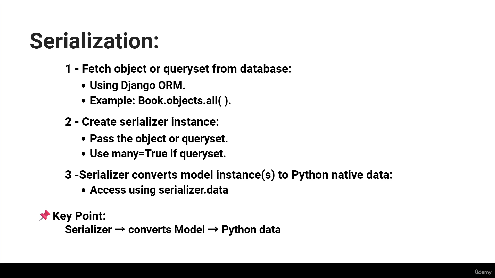

## Serializing one object and many objects (views + urls)

    - api/views.py:
        from .models import Person
        from .serializers import PersonSerializer

        def single_object_view(request):
            data = Person.objects.get(id=1)        # one object
            serializer = PersonSerializer(data)
            print(serializer.data)

        def multiple_objects_view(request):
            data = Person.objects.all()             # queryset
            serializer = PersonSerializer(data, many=True)
            print(serializer.data)
    - api/urls.py (new file):
        urlpatterns = [
            path('singleobj/', views.single_object_view, name='single_object_view'),
            path('multipleobj/', views.multiple_objects_view, name='multiple_objects_view'),
        ]
    - peoplehub/urls.py:
        path('', include('api.urls')),
    - Added a second Person in the admin (vettel, 45, hamburg).
    - Output in the runserver terminal:
        /singleobj/   -> {'name': 'Sachin', 'age': 28, 'city': 'Karwar'}
        /multipleobj/ -> [{'name': 'Sachin', 'age': 28, 'city': 'Karwar'},
                          {'name': 'vettel', 'age': 45, 'city': 'hamburg'}]
        One object -> a dict. many=True -> a list of dicts.
    - The browser shows an error (500), because the views only print and
      don't return anything:
        ValueError: The view api.views.multiple_objects_view didn't return an
        HttpResponse object. It returned None instead.
      Every Django view must return a response.
    - /singleobj (no slash) -> 301 redirect to /singleobj/ (APPEND_SLASH).
    - / -> 404, there is no route for the empty path in api/urls.py.

## Returning JSON: JSONRenderer + HttpResponse

    - api/views.py, both views now return a response instead of print():
        from rest_framework.renderers import JSONRenderer
        from django.http import HttpResponse

        def single_object_view(request):
            data = Person.objects.get(id=1)
            serializer = PersonSerializer(data)
            json_data = JSONRenderer().render(serializer.data)   # Python data -> JSON
            return HttpResponse(json_data, content_type='application/json')

        def multiple_objects_view(request):
            data = Person.objects.all()
            serializer = PersonSerializer(data, many=True)
            json_data = JSONRenderer().render(serializer.data)
            return HttpResponse(json_data, content_type='application/json')
    - The full chain now:
        model object / queryset --serializer--> Python dict / list
        --JSONRenderer().render()--> JSON (bytes) --HttpResponse--> browser
    - content_type='application/json' tells the browser it's JSON, not HTML.
    - The 500 error is gone. In the browser:
        /singleobj/   -> {"name": "Sachin", "age": 28, "city": "Karwar"}
        /multipleobj/ -> a JSON list with Sachin and vettel

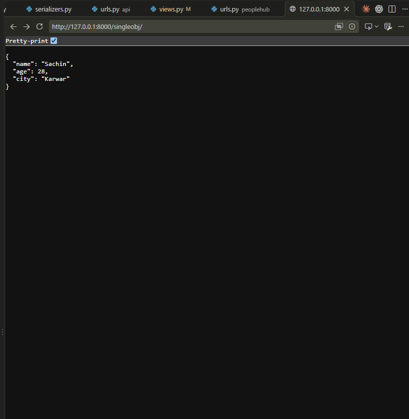

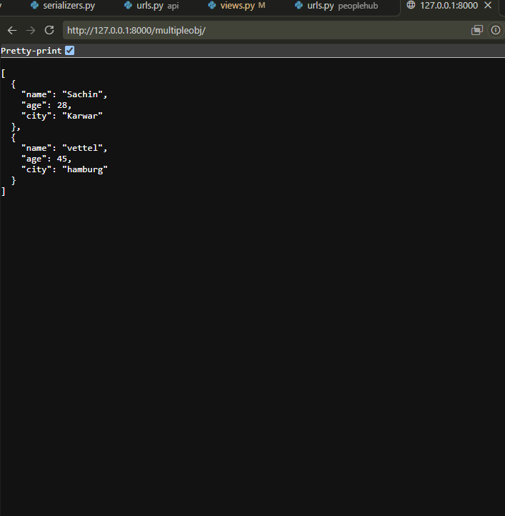

## De-serialization (course slides)

    - Serializers also provide deserialization: converting parsed data (JSON
      converted into Python primitive data types) into complex types, after
      validation.
    - Why:
        - Frontend apps send data in simple formats like JSON.
        - To create or update data, the user sends JSON to the backend.
        - Deserialization exists to safely interact with the database using
          user-provided data.
    - Parsing = converting the raw request data into Python primitives:
        - JSON arrives as a byte stream (the request body).
        - JSONParser parses the stream into Python data.
        - DRF handles parsing for us; manual parsing is only for learning.
    - De-serialization steps:
        1. Define create() / update() methods on the serializer.
        2. Pass the incoming data to the serializer object.
        3. Validate the data.
        4. Call save() to create the data in the DB.

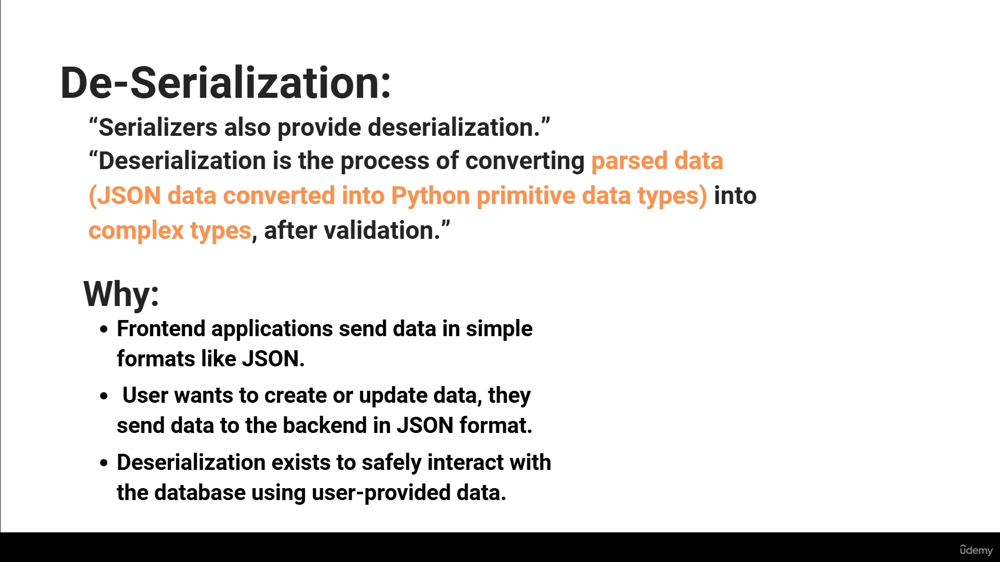

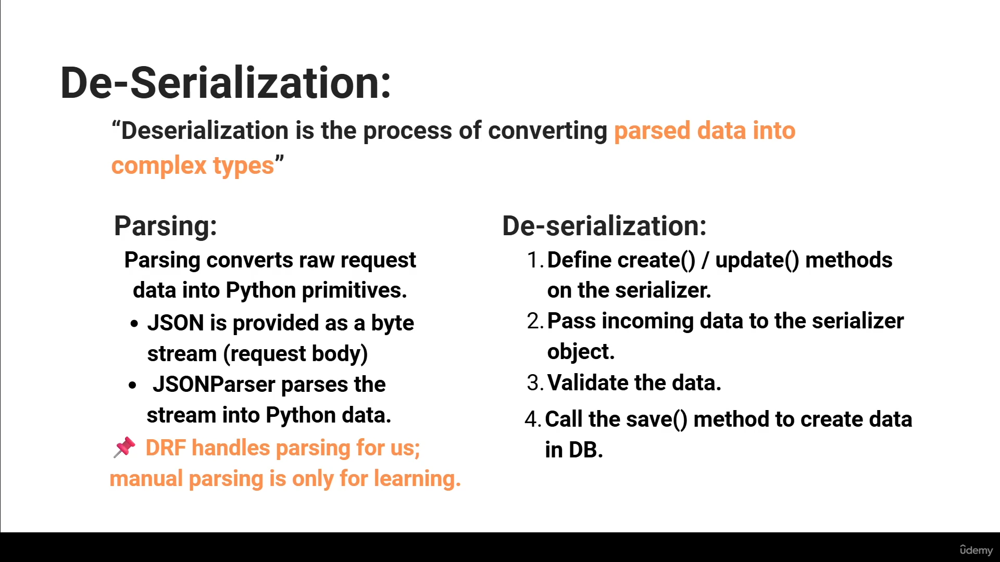

## Parsing a POST request by hand: io.BytesIO + JSONParser

    - api/views.py, multiple_objects_view now handles POST too:
        import io
        from rest_framework.parsers import JSONParser
        from django.views.decorators.csrf import csrf_exempt

        @csrf_exempt
        def multiple_objects_view(request):
            if request.method == 'POST':
                json_data = request.body                  # raw JSON bytes
                stream = io.BytesIO(json_data)            # bytes -> stream
                parsed_data = JSONParser().parse(stream)  # stream -> Python data
                print(parsed_data)
                print(type(parsed_data))

            data = Person.objects.all()
            ...                                           # GET part as before
    - @csrf_exempt: Postman has no CSRF token, so without it Django rejects
      the POST (403).
    - Sent with Postman: POST http://127.0.0.1:8000/multipleobj/,
      Body -> raw -> JSON. As cURL (Postman's code snippet):
        curl --location 'http://127.0.0.1:8000/multipleobj/' \
        --header 'Content-Type: application/json' \
        --data '{
            "name": "max",
            "age": 22,
            "city": "holland"
        }'
    - Terminal output:
        {'name': 'max', 'age': 22, 'city': 'holland'}
        <class 'dict'>
      The JSON text became a normal Python dict.
    - Response: 200 OK, the list with only Sachin and vettel. max is parsed
      and printed but not saved to the database yet.

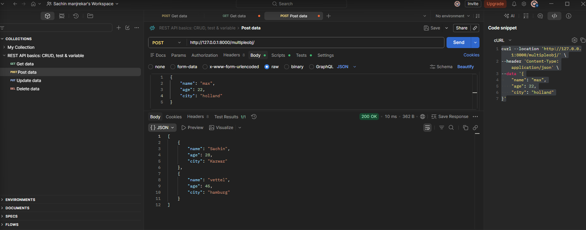

## Saving the data (course slide)

    - After validation, .save() is called.
    - .save() internally:
        - uses the validated data
        - calls create() or update()
    - We never call create() or update() directly.

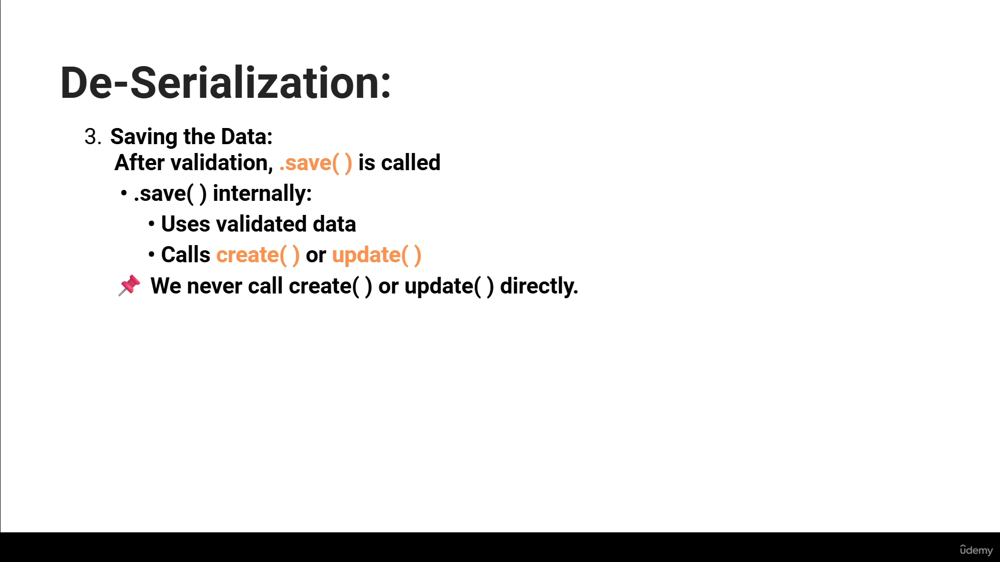

## De-serializing the POST: is_valid() + save() + create()

    - api/views.py, the POST part now saves the new Person:
        from django.http import HttpResponse, JsonResponse
        from rest_framework import status

        if request.method == 'POST':
            json_data = request.body
            stream = io.BytesIO(json_data)
            parsed_data = JSONParser().parse(stream)
            serializer = PersonSerializer(data=parsed_data)   # data= -> de-serialize
            if serializer.is_valid():
                serializer.save()
                return JsonResponse({"created": "success"}, content_type='application/json',
                                    status=status.HTTP_201_CREATED)
            else:
                return JsonResponse(serializer.errors, content_type='application/json',
                                    status=status.HTTP_400_BAD_REQUEST)
    - PersonSerializer(obj)        -> serialize (model -> Python data)
      PersonSerializer(data=dict)  -> de-serialize (Python data -> model)
      Rule: if data= is passed, the serializer de-serializes;
            otherwise it serializes.
    - is_valid() checks the data against the serializer fields
      (max_length, IntegerField, required). Errors go to serializer.errors.
    - JsonResponse = HttpResponse that turns a dict into JSON by itself.
    - status.HTTP_201_CREATED / HTTP_400_BAD_REQUEST: named status codes
      from DRF instead of plain 201 / 400.

    - Error 1: POST in Postman -> 500 Internal Server Error,
        NotImplementedError at /multipleobj/
      save() calls create(), but the plain Serializer class doesn't know how
      to create a Person, so create() must be written by us.

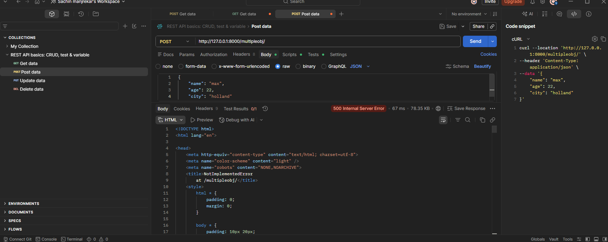

    - Fix, api/serializers.py:
        from .models import Person

        class PersonSerializer(serializers.Serializer):
            ...
            def create(self, validated_data):
                return Person.objects.create(**validated_data)
      validated_data = the checked dict {'name': 'max', 'age': 22, 'city': 'holland'}
      **validated_data -> Person.objects.create(name='max', age=22, city='holland')

    - Same POST again -> 201 Created, {"created": "success"}.
      max is now in the database (id 3, next to Sachin and vettel).

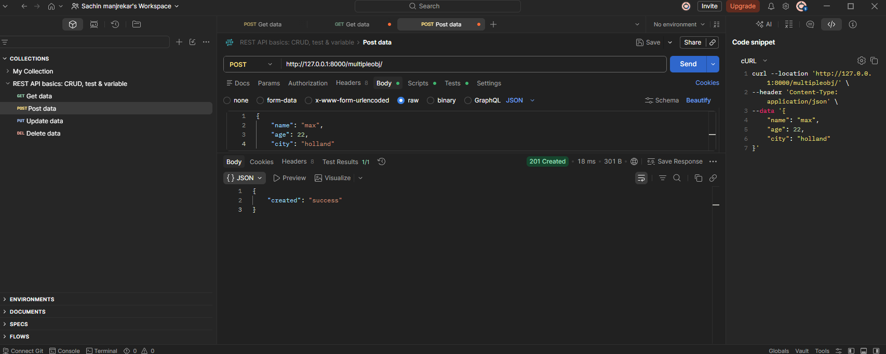

## Wrong types still pass: serializer fields convert values

    - POST with a number as name and text as age:
        curl --location 'http://127.0.0.1:8000/multipleobj/' \
        --header 'Content-Type: application/json' \
        --data '{
            "name": 456,
            "age": "44",
            "city": "france"
        }'
      -> 201 Created, saved as id 5: name '456', age 44, city 'france'.
    - Why it passes: the fields convert values to the right type when they can:

        | Field                  | Sent          | DRF does                        | Saved as |
        |------------------------|---------------|---------------------------------|----------|
        | name = CharField()     | 456 (number)  | number -> text                  | "456"    |
        | age = IntegerField()   | "44" (text)   | text that is a whole number -> int | 44    |
        | city = CharField()     | "france"      | already text                    | "france" |

    - What would fail is_valid():
        "age": "forty"     -> "A valid integer is required."
        "age": 4.5         -> fails too, no rounding
        "name": true       -> "Not a valid string." (true/false are rejected)
        a missing field    -> "This field is required."
        name > 100 chars   -> fails max_length
    - The fields only check type and limits (like length). Rules about the
      meaning (e.g. "a name must not be only digits") are something to add
      ourselves with validation methods on the serializer.

## JsonResponse instead of JSONRenderer + HttpResponse (safe=False)

    - api/views.py, the GET responses now use JsonResponse, which turns the
      Python data into JSON by itself (no JSONRenderer needed):
        def single_object_view(request):
            ...
            return JsonResponse(serializer.data, content_type='application/json')

        def multiple_objects_view(request):
            ...
            serializer = PersonSerializer(data, many=True)
            return JsonResponse(serializer.data, content_type='application/json', safe=False)
    - Error: GET /multipleobj/ before adding safe=False ->
        TypeError at /multipleobj/
        In order to allow non-dict objects to be serialized set the safe
        parameter to False.
      JsonResponse accepts only a dict by default (safe=True). With
      many=True, serializer.data is a list -> error.
      single_object_view works without it: one object -> a dict.

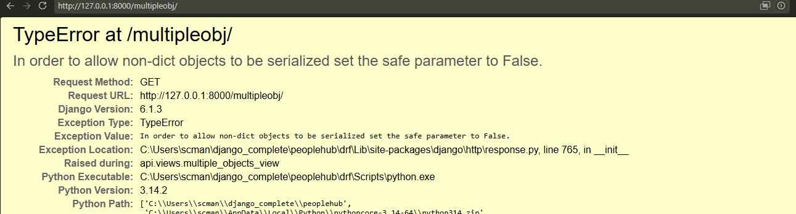

    - Fix: safe=False -> the list is allowed, /multipleobj/ shows all Persons
      as JSON again (now with max and ocon too).

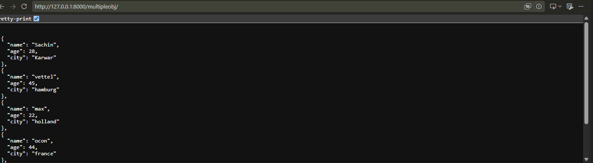

## Updating a Person: update() + PUT and PATCH

    - api/serializers.py, update() next to create():
        def update(self, instance, validated_data):
            instance.name = validated_data.get('name', instance.name)
            instance.age = validated_data.get('age', instance.age)
            instance.city = validated_data.get('city', instance.city)
            instance.save()
            return instance
      instance = the existing Person from the database.
      .get('name', instance.name) -> the new value if it was sent, otherwise
      keep the old one.
    - save() decides which one runs:
        PersonSerializer(data=...)            -> save() calls create()
        PersonSerializer(instance, data=...)  -> save() calls update()
    - api/urls.py, the id now comes from the URL:
        path('singleobj/<int:id>/', views.single_object_view, name='single_object_view'),
    - api/views.py:
        @csrf_exempt
        def single_object_view(request, id):
            data = Person.objects.get(id=id)
            if request.method == "PUT":
                stream = io.BytesIO(request.body)
                parsed_data = JSONParser().parse(stream)
                serializer = PersonSerializer(data, data=parsed_data)
                if serializer.is_valid():
                    serializer.save()
                    return JsonResponse({"updated": "success"}, content_type='application/json',
                                        status=status.HTTP_200_OK)
                else:
                    return JsonResponse(serializer.errors, content_type='application/json',
                                        status=status.HTTP_400_BAD_REQUEST)

            if request.method == "PATCH":
                ...same, but:
                serializer = PersonSerializer(data, data=parsed_data, partial=True)
    - PUT vs PATCH:
        PUT   -> full update, all fields must be sent (missing field -> 400
                 "This field is required.")
        PATCH -> partial update, partial=True, only the sent fields change
    - Person 1 updated: now name 'Sachin cm', age 23, city 'usa'.

    - Error 1: PUT to http://127.0.0.1:8000/singleobj/1 (no slash) -> 500
        RuntimeError: You called this URL via PUT, but the URL doesn't end in
        a slash and you have APPEND_SLASH set. Django can't redirect to the
        slash URL while maintaining PUT data.
      For GET, Django redirects to the URL with a slash (301). For PUT it
      can't, the body would be lost. Fix: /singleobj/1/ with the slash.
    - Error 2: PUT to /singleobj/1/ -> 403
        Forbidden (CSRF cookie not set.)
      Django checks CSRF on every request that changes data (POST, PUT,
      PATCH, DELETE). Postman sends no CSRF token. Fix: @csrf_exempt on
      single_object_view too (multiple_objects_view already had it).
    - Error 3: PATCH /singleobj/22/ -> 500
        DoesNotExist at /singleobj/22/
        Person matching query does not exist.
      Only ids 1-5 exist. Person.objects.get(id=22) on line 15 crashes before
      the PATCH code or is_valid() run, so the body (even "age": "dsfgdes")
      is never checked. Fix: use an id that exists, e.g. /singleobj/1/.
    - On the way: the PATCH code was first written in multiple_objects_view
      (id taken from the JSON body). A PATCH to /singleobj/<id>/ never
      reached it, single_object_view only handled PUT and returned None.
      Moved into single_object_view, next to PUT.

## get_object_or_404: 404 instead of a 500 crash

    - api/views.py:
        from django.shortcuts import get_object_or_404

        def single_object_view(request, id):
            data = get_object_or_404(Person, id=id)
    - Before: Person.objects.get(id=22) -> DoesNotExist -> 500 error page.
      Now: /singleobj/22/ -> 404 Not Found, the right answer for an id that
      doesn't exist. Ids 1-5 work as before.

## ModelSerializer (course slides)

    - ModelSerializer = a DRF serializer that is a shortcut: it creates the
      serializer fields automatically from a Django model's fields.
    - Key points:
        - creates serializer fields from the model fields automatically
        - uses the model's validations automatically
        - includes default create() and update() methods
        - less code to write
    - Syntax:
        class PersonSerializer(serializers.ModelSerializer):
            class Meta:
                model = Account
                fields = ['name', 'city', 'age']    # a list or "__all__"
                # or:
                exclude = ['users']                 # all fields except these
    - Define either fields or exclude, not both at once, otherwise
      AssertionError.

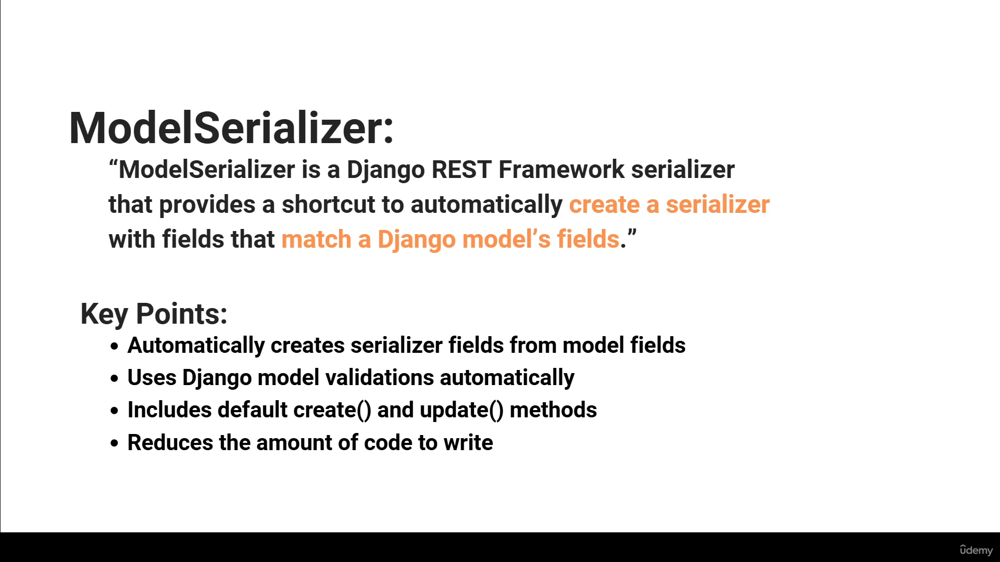

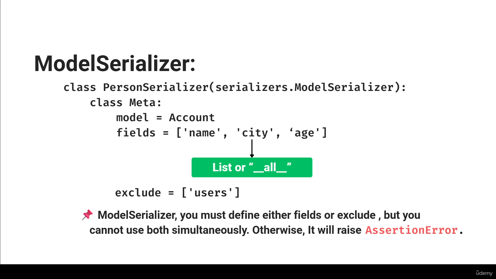

## PersonModelSerializer: the views use ModelSerializer now

    - api/serializers.py, new class below PersonSerializer:
        class PersonModelSerializer(serializers.ModelSerializer):
            class Meta:
                model = Person
                fields = ['name', 'age', 'city']
      No fields written by hand, no create() / update(): ModelSerializer
      reads the fields from the Person model (max_length=100,
      PositiveIntegerField ...) and has create() and update() built in.
    - api/views.py: PersonSerializer -> PersonModelSerializer everywhere:
        from .serializers import PersonSerializer, PersonModelSerializer

        PUT:   PersonModelSerializer(data, data=parsed_data)
        PATCH: PersonModelSerializer(data, data=parsed_data, partial=True)
        POST:  PersonModelSerializer(data=parsed_data)
        GET /multipleobj/: PersonModelSerializer(data, many=True)
      The views work the same as with PersonSerializer.

    - Error: GET /singleobj/1/ in the browser ->
        ValueError at /singleobj/1/
        The view api.views.single_object_view didn't return an HttpResponse
        object. It returned None instead.
      single_object_view only returned something for PUT and PATCH. A GET
      skipped both ifs and reached the end of the function -> None.
    - Fix: a GET response at the end of single_object_view:
        # GET: return the single object as JSON
        serializer = PersonModelSerializer(data)
        return JsonResponse(serializer.data)
      No safe=False needed: one object -> a dict.
    - Checked:
        GET /singleobj/1/  -> 200 {"name": "Sachin vee", "age": 44, "city": "usa"}
        GET /singleobj/22/ -> 404
        GET /multipleobj/  -> 200, the full list

## Helpful resources

    - Django docs:
        https://docs.djangoproject.com/en/6.1/
    - Django REST Framework (DRF) docs:
        https://www.django-rest-framework.org/
    - DRF serializer fields (CharField, IntegerField, ...):
        https://www.django-rest-framework.org/api-guide/fields/
